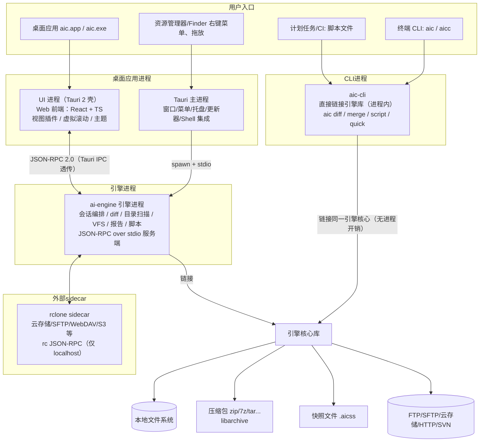
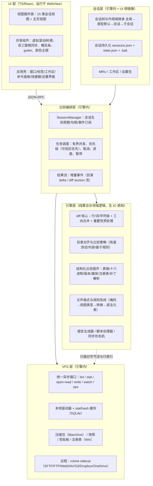
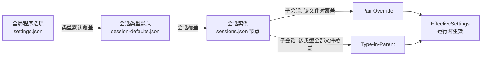
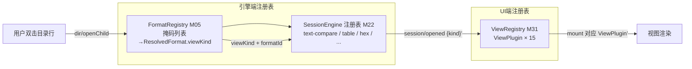
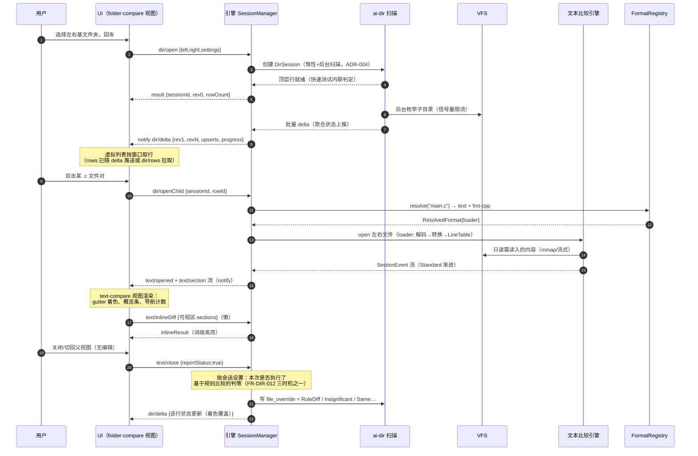
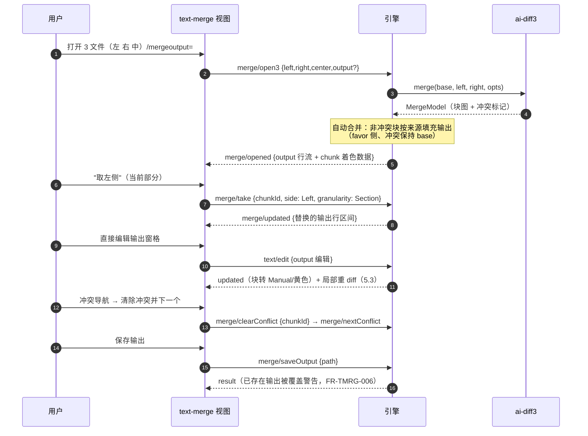
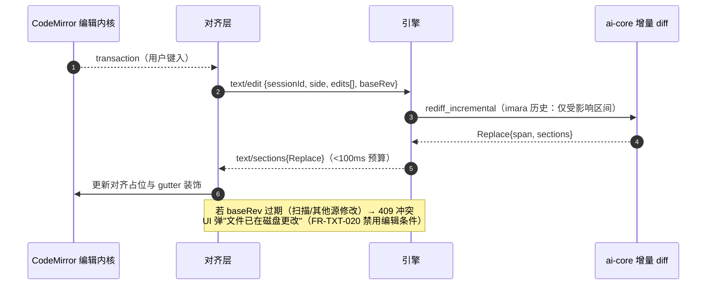

# ai-compare 架构设计文档

| 项目 | 内容 |
| --- | --- |
| 文档编号 | 03 |
| 项目代号 | ai-compare（完整复刻 Beyond Compare 功能的跨平台比较/合并工具） |
| 文档目的 | 定义系统总体架构、模块划分、核心数据结构、关键流程、横切关注点、质量属性与风险对策，作为后续详细设计与开发计划的架构基线 |
| 输入依据 | `01-需求规格说明书.md`（163 个编号需求，下称 SRS）、`02-开源竞品与技术调研报告.md`（下称调研报告） |
| 编写日期 | 2026-11-13 |
| 编写角色 | 资深软件架构师 |
| 技术基线 | Rust headless 比较引擎（独立进程/独立库）+ Tauri 2 + Web 前端 + CLI，进程间 JSON-RPC over stdio |

---

## 目录

1. 引言
2. 架构总览
   - 2.1 系统上下文与进程视图
   - 2.2 五层逻辑架构
   - 2.3 进程间协议：JSON-RPC over stdio
   - 2.4 关键架构决策记录（ADR）
3. 模块划分
   - 3.1 引擎层
   - 3.2 协议层
   - 3.3 会话层
   - 3.4 UI 层
   - 3.5 比较类型插件三元组（端到端视角）
4. 核心数据结构
5. 关键流程时序
6. 横切关注点
7. 目录结构规划（monorepo）
8. 质量属性
9. 风险与对策
10. 附录

---

# 1. 引言

## 1.1 设计目标

以 SRS 的 163 个编号需求（FR×156 + NFR×7）为完整范围，以调研报告的技术结论为选型基线，给出满足以下目标的架构：

1. **引擎与 UI 硬隔离**（调研报告结论 6.2-1）：比较/合并/扫描/脚本/报告全部在无 UI 依赖的 Rust headless 引擎中实现；引擎可独立运行（CLI、脚本、CI、自动化测试），UI 只是引擎状态的投影。
2. **P0 → V2.0 渐进交付**：架构不因里程碑推进而推翻重来；P2/Pro 功能（三向合并、对齐覆盖、注册表等）是许可门控下的特性开关，而非架构分叉（SRS 1.2 实现含义）。
3. **性能目标可达成**：10 万+ 目录项流式比较、GB 级文件可打开、编辑后局部重 diff < 100ms——这些要求决定了"引擎持有全量模型 + UI 窗口化取数"的核心模式（调研报告 6.2-6 性能设施先行）。
4. **可复用资产池优先**：similar / imara-diff / diffy / tree-sitter / VS Code diff 算法（MIT/Apache）直接复用；GPL 竞品（Meld/KDiff3/WinMerge）仅参考行为与架构，不复用代码（风险 R1）。

## 1.2 与输入文档的关系及冲突点标注

本设计原则上完全服从两份输入文档；以下差异点为**有意的工程化偏离**，逐条标注并在 ADR 中论证：

| # | 冲突/偏离点 | 输入文档表述 | 本设计决策 | 标注 |
| --- | --- | --- | --- | --- |
| C1 | 正则引擎 | SRS 多处以 PCRE 为正则语义基准（FR-FMT-003、FR-TXT-022、脚本 RENAME 等） | 采用 Rust `regex`（快速路径）+ `fancy-regex`（回溯路径，支持前后查找）双引擎；语义覆盖 PCRE 常用子集，个别极端特性（递归匹配、callout）不支持，UI 帮助中明示 | ADR-006 |
| C2 | UI 框架评分 | 调研报告决策矩阵中 Electron 4.15 略高于 Tauri 4.10 | 遵循调研报告推荐结论（Tauri 2 首选、Electron 保底）；矩阵分差小的前提正是"引擎与 UI 分离"，故该选择保持可逆 | ADR-001 |
| C3 | 会话文件格式 | SRS 2.6 实测 BC 为单一 `BCSessions.xml`（版本化 XML） | 采用**单一 JSON 文件 + 版本字段 + 原子写 + .bak**（结构对齐 BC 的"类型化节点 + 文件夹树 + State 子结构"），并提供 BC XML **只读导入器**（V2.0） | ADR-005 |
| C4 | 快照格式 | SRS 使用 `.bcss` 专有二进制 | 定义自有开放格式 `.aicss`（zstd 压缩的 JSON 行流），不与 BC 二进制兼容 | 6.5 节 |
| C5 | 脚本语言细节 | SRS FR-SCR 规定 `%VAR%` 环境变量、`&` 续行、大小写不敏感 | 完整照搬该文法（含 `%date%` 等动态变量），保证既有 BC 脚本近乎零成本迁移 | 3.1.8 |

其余无冲突：SRS 的优先级划分（P0/P1/P2）直接映射到开发计划（文档 04）的里程碑；调研报告的五层分层与"比较类型插件三元组"启示直接映射到本文档第 3 章模块划分。

---

# 2. 架构总览

## 2.1 系统上下文与进程视图

系统由三类可执行形态构成，共享同一个引擎核心（同一组 Rust crate）：



**关键约束：**

1. **引擎是一等公民，UI 是投影**。所有比较状态（目录树、diff 块、合并输出、过滤器结果）持久驻留在引擎进程的内存模型中；UI 通过协议窗口化读取（分页取目录行、取可视区 diff 段）。UI 崩溃/重载不丢失比较状态（开发期热重载即受益）。
2. **CLI 不走进程间通信**：`aic-cli` 直接以库形式链接引擎核心，避免 stdio 序列化开销，同时保证脚本/CI 场景零依赖可运行（FR-CLI、FR-SCR）。GUI 场景才 spawn 独立引擎进程。两条路径共享同一 Rust API（`ai_engine::SessionManager`），协议层只是该 API 的一层薄封装——**同一契约，两种宿主**。
3. **单实例约定**（FR-CLI-001）：第二个 GUI 实例将参数转发给既有实例后退出（Tauri 单实例插件 + 本地 socket）。
4. **远程/云存储不进引擎主进程**：rclone 以 sidecar 子进程形态按需拉起，`rc` API 仅监听 127.0.0.1（风险 R4 缓解）。

## 2.2 五层逻辑架构

对齐调研报告 6.1 的共性分层（自上而下）：



层次规则：

- **L2 引擎层只面对"行数组 / 字节流 / 元数据"，不感知来源**（调研报告 6.2-3：所有比较引擎只面对字节流 + 行索引）。
- **L1 VFS 层是唯一做 IO 的层**；文件操作（复制/删除/重命名）也定义在 VFS 能力接口上，使压缩包内、远程端可按能力降级（FR-DIR-060~068 的边界条件）。
- **L3 编排层拥有全部可变状态**；L2 计算结果不可变（调研报告 6.2-4：结果模型不可变 + 流式）。
- **L4 会话层在引擎侧持久化**（CLI/脚本也需要会话），UI 侧仅缓存展示态。

## 2.3 进程间协议：JSON-RPC over stdio

### 2.3.1 选型理由（详见 ADR-003）

1. **经过验证的先例**：LSP（Language Server Protocol）证明了"stdio 上的 JSON-RPC 支撑编辑器级高频交互"的可行性，工具链（调试、日志回放）成熟。
2. **与宿主解耦**：引擎不依赖 Tauri IPC、不依赖 Node；同一协议可被 CLI、测试框架、未来第三方工具（VS Code 扩展、CI 服务）复用——协议本身就是公开产品面。
3. **可调试可录制**：行分隔 JSON（NDJSON，每行一条 JSON-RPC 2.0 消息）可直接 `tee` 到日志文件做回放测试（golden test 的协议级形态）。
4. **双向与推送**：notification 天然支持引擎→UI 的增量推送（目录扫描进度、diff 渐进结果）；server→client request 预留（如"需要用户确认覆盖"在脚本静默模式外回流 UI）。
5. **批量与背压**：JSON-RPC 批量请求 + 引擎侧合并写入（每 ~16ms 或每 500 条 flush 一次 delta），控制 10 万项目录的序列化开销（风险 R9 缓解）。

### 2.3.2 消息模型

```jsonc
// ---- UI → 引擎：请求（带 id，引擎必须应答） ----
{"jsonrpc":"2.0","id":1,"method":"dir/open","params":{"left":"/a","right":"/b","sessionId":"s1","criteria":{...}}}
// ---- 引擎 → UI：应答 ----
{"jsonrpc":"2.0","id":1,"result":{"sessionId":"s1","rowCount":0,"scanState":"running"}}
// ---- 引擎 → UI：通知（增量推送，无需应答） ----
{"jsonrpc":"2.0","method":"dir/delta","params":{"sessionId":"s1","rev":42,"upserts":[...],"removals":[...],"progress":{"scanned":8213,"total":null}}}
// ---- UI → 引擎：通知（取消，LSP 风格） ----
{"jsonrpc":"2.0","method":"$/cancel","params":{"id":99}}
```

协议要点：

| 机制 | 设计 |
| --- | --- |
| 传输帧 | NDJSON（每行一条消息，UTF-8，`\n` 分隔）。JSON 字符串内换行已被转义，无歧义；比 `Content-Length` 头更易人肉调试。备选：若单消息超 32MB（超大 diff 全量导出）则改用分页参数而非改帧 |
| 会话寻址 | 所有请求携带 `sessionId`（引擎分配的句柄）；会话树/子会话关系由 `session/` 前缀方法管理 |
| 增量一致性 | 每个会话模型带单调递增 `rev`；UI 持有本地投影，按 delta 追平；断线/失序时调用 `state/resync` 全量重建 |
| 取消 | `$/cancel` + 任务 CancellationToken 贯穿引擎全链路（KDiff3 ProgressProxy 模式） |
| 进度 | 统一 `progress` 通知：`{token, done, total?, message?, cancellable}`；文件操作队列额外支持 `pause`/`resume`（FR-OP-003） |
| 大内容 | 文本行数据按需分页 `text/lines {sessionId, side, start, count}`；十六进制 `hex/range`；图片不走内容行，由引擎解码后按 tile 分块（`picture/tiles`）；行内 diff 结果 `text/inlineDiff {sectionId}` 懒计算 |
| 错误 | JSON-RPC error 对象 + 领域错误码表（对齐 FR-CLI-004 退出码语义，见附录 B） |
| 版本协商 | 握手 `initialize {clientInfo, protocolVersion}` → 引擎返回能力集（启用哪些视图类型/许可门控），UI 据此隐藏不可用视图（Pro 门控的 UI 面） |
| 二进制优化通道（预留） | 协议 v2 预留 CBOR 编码协商与共享内存通道；v1 保持纯 JSON，先用数据证明是否需要 |

### 2.3.3 协议方法命名空间（摘要）

| 前缀 | 职责 | 示例方法 |
| --- | --- | --- |
| `app/` | 握手、能力、退出、设置读写 | `initialize`, `shutdown`, `settings/get`, `settings/set` |
| `session/` | 会话树 CRUD、保存/加载、作用域、MRU、工作区 | `session/new`, `session/save`, `session/list`, `session/settingScope` |
| `dir/` | 目录比较打开/刷新/展开/过滤/排序/行窗口 | `dir/open`, `dir/rows {offset,count}`, `dir/filter`, `dir/expand` |
| `op/` | 文件操作（复制/移动/删除/重命名/属性/touch） | `op/copy`, `op/delete`, `op/pause`, `op/queue` |
| `text/` | 文本比较：diff 流、行窗口、行内 diff、编辑、保存 | `text/open`, `text/lines`, `text/inlineDiff`, `text/edit`, `text/save` |
| `merge/` | 三向合并：自动合并、take、冲突操作 | `merge/open3`, `merge/take`, `merge/clearConflict`, `merge/saveOutput` |
| `sync/` | 同步预览/执行 | `sync/preview`, `sync/run` |
| `table/ hex/ pix/ media/ ver/ reg/` | 各结构化视图 | `table/open`, `hex/range`, ... |
| `report/` | 报告生成（HTML/文本/补丁/XML/统计） | `report/generate {kind, layout, options}` |
| `fmt/` | 文件格式列表/编辑、语法元素、探测结果 | `fmt/list`, `fmt/save`, `fmt/probe {path}` |
| `vfs/` | profile 管理、压缩包配置、快照 | `vfs/profiles`, `vfs/snapshot/save` |

## 2.4 关键架构决策记录（ADR）

> 格式：背景 / 选项 / 决策 / 后果。所有 ADR 一经批准即冻结，修订需走变更记录。

### ADR-001 UI 框架：Tauri 2 + Web 前端（React + TypeScript），Electron 为保底

- **背景**：SRS 要求三平台（Win/macOS/Linux）一致 UI；硬需求含 10 万+ 节点虚拟列表、GB 级文本视图、双/三窗格同步滚动、可插拔异构视图（调研报告 4.2）。
- **选项**：A Electron；B Tauri 2 + Web；C Qt/C++；D 纯 Native；E Flutter。
- **决策**：**B**。前端框架选 **React 18 + TypeScript + TanStack Virtual + CodeMirror 6**（Monaco 仅作为可选降级组件，风险 R2）。理由：调研报告决策矩阵与推荐结论（引擎与 UI 分离后该选择可逆）；Rust 生态协同（similar/imara-diff/tree-sitter 全家桶）；体积/内存接近"工具软件"质感。矩阵中 Electron 总分（4.15）略高于 Tauri（4.10），但该分差的前提正是本架构已把决策重心移到"引擎/UI 分离"，故接受。
- **后果**：需应对三 WebView 差异（风险 R3）——渲染核心组件（虚拟列表、文本视图）必须自己做性能抽象并在 CI 三平台跑帧率回归；若 Linux WebKitGTK 不可接受，启动 Electron 保底路径：前端代码 100% 复用（这是本架构的最大红利），仅替换壳层与引擎 spawn 方式（Node child_process）。

### ADR-002 引擎语言与形态：Rust，headless 库 + 独立进程双形态

- **背景**：FR-CLI/FR-SCR 要求引擎可独立运行；NFR-PERF 要求 GB 文件/10 万目录；调研报告可复用资产池以 Rust 为核心（similar、imara-diff、diffy、difftastic、tree-sitter、libarchive 绑定、memmap2、xxhash）。
- **选项**：Rust 单语言引擎；TS 引擎（Node）+ jsdiff；C++ 引擎 + FFI；Go 引擎（含 rclone 同源）。
- **决策**：**Rust**。引擎编译为（a）静态库 crate 供 CLI 进程内链接；（b）`ai-engine` 独立二进制作为 GUI 的 sidecar，stdin/stdout 上服务 JSON-RPC。diff 核心以 **imara-diff（历史化增量 diff，支撑编辑后局部重算）+ similar（行内 word/char diff 与 unified 输出）** 为底座，三向合并基于 **diffy(-imara)** 思路自研块图合成（对齐 SRS 2.3 状态分类：未更改/相同更改/仅左/仅右/冲突）。
- **后果**：引擎层 100% 无 UI 依赖、可全量单测（质量属性 8.2）；团队需要 Rust 能力（开发计划给出人才 ramp-up 预算）；与 rclone（Go）通过进程边界隔离，不做库链接（ADR-007）。

### ADR-003 进程间协议：JSON-RPC 2.0 over stdio（NDJSON 帧）

- **背景**：UI（WebView 内 TS）↔ 引擎（Rust 子进程）需要双向、流式、可扩展通信；同一引擎还要服务 CLI 与未来嵌入场景。
- **选项**：① JSON-RPC over stdio；② Tauri 原生 IPC command（进程内 sidecar API）；③ gRPC；④ WebSocket/本地 socket + 自定义协议；⑤ 自定义二进制（flatbuffers）。
- **决策**：**①**。理由见 2.3.1。Tauri sidecar 通道仅作为字节管道（把 stdin/stdout 透传给前端），协议语义不绑定 Tauri；`ai-engine --stdio` 可脱离 GUI 独立运行供测试与脚本驱动。
- **后果**：JSON 序列化有开销——通过"引擎持模型 + UI 窗口化取数 + delta 批量"把协议流量与数据总量解耦（风险 R9）；预留 CBOR/共享内存升级通道但不提前建设。

### ADR-004 目录扫描并发模型：有界并行 + 惰性展开 + 可视区优先 + 持久 stat/hash 缓存

- **背景**：FR-DIR-043（后台扫描/展开策略三态）、FR-BIG-001（快速测试先行、CRC 惰性）、NFR-PERF-001；10 万+ 节点目标；远程目录 IO 延迟高且需并发（FR-VFS-002a 连接数 1-10 可配）。
- **选项**：① 全量递归一次扫完再显示（简单，首屏慢）；② 纯惰性按展开扫描（首屏快，聚合状态不准）；③ 混合：顶层立即 + 后台全量 + 可视优先；④ 每目录一个 OS 线程（失控）；⑤ actor 池 + 工作窃取。
- **决策**：**③+⑤**。tokio 异步运行时，目录枚举任务以 actor 化"扫描单元"入队，信号量限并发（本地默认 `min(32, cpus*4)`，远程按 profile 连接数）；队列带两级优先级（UI 可视/展开请求 > 后台全量扫描）；每目录聚合状态（FR-DIR-002）随 delta 增量上推。快速测试（size/timestamp/属性，FR-DIR-010）在扫描线程内联完成；内容比较（CRC/二进制/规则，FR-DIR-011）进入独立的比较工作池（CPU 哈希与远程 IO 分池），受"快速测试相同则跳过"门控。`(path, size, mtime_ns)` → 内容比较结果 的**持久缓存**（SQLite，Meld CacheResult 模式）跨会话复用；zip 等预计算 CRC 直接采用。全链路 CancellationToken 取消。
- **后果**：目录模型必须是"状态机 + 增量事件"而非一次性返回（数据结构 4.2）；后台扫描与用户操作竞态需要 rev 乐观并发（UI 端操作基于过期 rev 被引擎拒绝并要求 resync）；缓存失效依赖 mtime+size（外部修改且 mtime 不变的风险接受，与 BC 一致）。

### ADR-005 会话持久化格式：版本化单一 JSON 文档 + 原子写 + .bak

- **背景**：SRS 2.6 实测 BC 的 `BCSessions.xml`（类型化会话节点 + TSessionFolder 树 + State 子结构）、`BCState.xml`（MRU/窗口）、每次保存生成 `.bak`；FR-SES-001/003/006 的保存/默认值/作用域；FR-SET-001 便携模式。
- **选项**：① 对齐 BC 的 XML（可互操作）；② 单一 JSON 文档；③ 每会话一文件的目录树；④ SQLite。
- **决策**：**②**。`sessions.json`（`{version, folders:[...], sessions:[...]}`，节点结构与 BC XML 同构：类型化节点 + 嵌套文件夹 + `state` 子对象）与 `state.json`（MRU/窗口/更新检查状态）分置；写入用"临时文件 + rename"原子替换，成功后滚动一份 `.bak`。作用域继承（全局→类型默认→会话，FR-SES-006）在文档内以"设置对象只存覆盖项、读取时逐层合并"实现（见 4.3）。
- **后果**：人可读、diff 友好、迁移简单；BC `BCSessions.xml` 的**只读导入器**列为 V2.0 交付（FR-SET-002 导入导出体系的一部分）；单文件在会话数极多（>2000）时读写性能需要基准看护（预期无忧：纯文本 < 5MB）。

### ADR-006 正则引擎：`regex` + `fancy-regex` 双引擎，PCRE 兼容子集

- **背景**：SRS 语法项/查找替换/重命名/其他过滤器均以 PCRE 语义描述（含前后查找的可能用法）；FR-TXT-022 要求"插入正则表达式元素"辅助 UI。
- **决策**：默认 `regex` crate（线性时间，无回溯爆炸）；语法含 lookaround/backreference 时自动切 `fancy-regex`（MIT，回溯 + 超时保护）。文档化不支持的 PCRE 特性清单（递归子模式、\G、callout）。
- **后果**：杜绝 ReDoS（安全 NFR-SEC）；与 PCRE 的行为差异在帮助文档"正则参考"页明示（冲突点 C1）。

### ADR-007 远程 VFS：rclone sidecar，按需下载组件

- **背景**：FR-VFS-001 覆盖 FTP/FTPS/SFTP/WebDAV/S3/Dropbox/OneDrive/SVN/MTP/HTTP；自研全部协议成本极高；调研报告推荐 rclone（MIT，70+ 后端）sidecar 方式。
- **决策**：远程访问统一走 rclone sidecar（`rc` JSON-RPC，仅 localhost，随机端口 + token）。FTP 明确列为例外：FTP 的控制粒度（FR-VFS-002a 六页设置：MODE Z、EBCDIC、LIST 协商、被动端口范围等）超出 rclone 抽象，P1 用 Rust `suppaftp` + `ssh2` 自研（对齐 BC 的 FTP 深度调优卖点）；SFTP 在 V1.0 先走 rclone（够用），V2.0 评估自研深度参数。
- **后果**：分发体积与安全面（风险 R4）——远程支持为**可选组件**，首次使用时引导下载或随安装包提供勾选；SVN 仓库（FR-VFS-002b）通过 `svn` CLI 或 rclone webdav 桥接实现（V2.0）。

### ADR-008 文本编辑器组件：CodeMirror 6 为编辑内核 + 自绘 diff 布局层

- **背景**：FR-TXT-020 全功能编辑、编辑即实时重 diff（调研报告 6.2-5）、行内高亮、可见空白、语法高亮、自动换行（BC5）、大文件虚拟化；Monaco 大文件弱且 merge editor 不随 npm 包发布（调研报告 2.7）。
- **决策**：**CodeMirror 6**（MIT）作为文本编辑内核（撤销栈、输入法、无障碍、行内 widget），差异布局（gutter、行背景、对齐占位空行、三窗格同步）在 CM6 之上自研"对齐层"扩展；@codemirror/merge 仅作交互参考不复用其布局引擎（我们要的是 BC 式 section 模型而非通用 merge 装饰）。语法高亮：Shiki（TextMate 语法）离线注入 token；超长行/超大 hunk 降级策略对齐 delta（调研报告 2.8）。
- **后果**：自研对齐层是 UI 侧最大技术风险之一（风险 R10），walking skeleton 即验证（开发计划 3 节）；十六进制/表格视图完全自绘（canvas + 虚拟滚动），不用编辑器组件。

### ADR-009 许可与 Pro 特性门控：特性开关而非架构分叉

- **背景**：SRS 1.2：Pro 专属 = 三向合并/文本替换/对齐覆盖/SCC/SFTP/注册表比较；"架构上所有会话类型统一实现，由许可证状态决定可用性"。
- **决策**：统一 `LicenseCapabilities`（引擎启动时注入，协议 `initialize` 返回）；功能注册表按 capability 声明；UI 与 CLI 双端统一门控。开源/自用场景默认全能力（等价 Pro 试用态）。
- **后果**：P2/Pro 功能开发顺序完全由开发计划的价值排序决定，不被许可体系拖拽。

### ADR-010 与 Beyond Compare 的兼容边界：行为兼容优先，数据格式不承诺双向

- **背景**：目标是"完整复刻功能"，用户已有 BC 使用习惯与资产（会话、脚本、.bcss、右键菜单语义）。
- **决策**：① CLI 参数/开关/退出码**语义兼容**（FR-CLI-003/004 照搬，`/` 与 `-` 前缀按平台）；② 脚本语言**文法兼容**（C5）；③ 会话 XML 只读导入（V2.0）；④ .bcss 快照不兼容，提供自有 .aicss；⑤ 颜色/快捷键默认值对齐 BC（降低迁移成本）。
- **后果**：既有 BC 脚本与 VCS 集成配置（difftool/mergetool 指向）可以平移；二进制资产（registry.dat 等）完全不做兼容。

### ADR-011 桌面发行形态：引擎随包分发 + 壳内引擎解析顺序固定

- **背景**：ADR-002/003 规定引擎为独立进程（sidecar，stdio JSON-RPC），但 Tauri 2 的 `bundle` **不自动携带引擎二进制**；壳在 release 下须能定位引擎，否则发行包启动即报「未找到引擎可执行文件」。本轮（2026-11-14）实测踩中两坑：① `tauri build --bundles dmg` 会重建 `bundle/macos/*.app`，把后置放入的引擎覆盖掉；② 其 `bundle_dmg.sh` 需挂载/卸载卷，无头/沙箱环境以 `hdiutil couldn't unmount - 资源忙` 失败。
- **选项**：A Tauri `externalBin`（官方 sidecar 机制，文件名须带 target triple，dev 模式亦要求该文件存在）；B 打包后手工把引擎复制进 `Contents/MacOS/` 并重新签名；C 引擎链接进壳（同进程，违背 ADR-002 进程隔离）；D 安装期单独安装引擎到系统目录（引入安装器与路径不确定性）。
- **决策**：**B**（`scripts/build-app.sh` 固化：引擎 release → 前端 → `tauri build --bundles app` → 复制 `ai-engine` 进 `ai-compare.app/Contents/MacOS/` → `codesign --force --deep --sign -` 重建签名）。壳内引擎解析顺序**冻结**为：`AI_ENGINE_PATH` 环境变量/显式参数 → debug 构建的仓库约定路径 `<repo>/target/debug/ai-engine` → **release 下与可执行文件同目录**（macOS 即 `Contents/MacOS/ai-engine`）。DMG 用 `hdiutil create -srcfolder <含引擎的 .app>` 生成（不挂载卷，避免 A 的 dev 前置要求与 B 的 `bundle_dmg.sh` 卸载失败）。
- **后果**：① 发行包自包含（`Contents/MacOS/ai-engine`），但**新增可执行文件会使既有签名失效**，故「复制 + 重签名」必须成对执行，缺一即启动被系统拒绝；② `AI_ENGINE_PATH` 与 debug 路径在 release 下不参与解析，杜绝发行包误用开发机上的慢/异版本引擎；③ 缺引擎时的报错文案按 `debug_assertions` 分流——release 提示「安装包不完整，请重新获取」，不再指引桌面用户去仓库执行 `cargo build`；④ A（`externalBin`）留作后续选项：待需要 dev/发行同源 sidecar 时再切换，届时须保证 `src-tauri/binaries/ai-engine-<triple>` 存在（当前 `pnpm tauri dev` 依赖仓库内 debug 引擎，故未采用）；⑤ 签名当前为 ad-hoc，**公证（notarization）与自动更新仍属 P13 未完成项**。

---

# 3. 模块划分

> 模块编号 M-xx 在开发计划中直接引用。每个模块给出：职责、对外接口（Rust trait 或 TS interface 草案）、依赖关系。

## 3.1 引擎层（Rust workspace crates）

### 3.1.1 M01 `ai-core`：diff 核心算法（纯函数，无 IO）

- **职责**：
  - 行级 diff：**标准对齐（分块渐进）**、**Myers O(ND)**（一次性全量）、**Patience**、**Histogram** 四算法（FR-TXT-011、FR-TBL-004）；底层 imara-diff + similar；
  - 词级/字符级行内 diff（懒计算入口，超时与长度上限，对齐 delta 启发式）；
  - 重要性预处理：把行映射为"规范化哈希"（空白三类/大小写/行尾/语法元素忽略/替换表/行权重），diff 在规范化键上运算、在原文上渲染（FR-TXT-010、FR-TXT-012）；
  - 手动对齐/隔离锚点：锚点区间内重新 diff（KDiff3 ManualDiffHelpList 模式，FR-TXT-011）；
  - 相似度（接近度）匹配：剩余不匹配行的相似对齐（可选）；
  - 编辑增量 diff：基于 imara-diff 历史，输入编辑 patch 只重算受影响区间（FR-TXT-020 编辑即重 diff）。
- **接口草案**：

```rust
pub enum LineAlignAlgo { Standard, Myers, Patience, Histogram }

pub struct TextDiffOptions {
    pub algo: LineAlignAlgo,
    pub importance: ImportanceRules,      // 空白三类/大小写/行尾/语法元素/替换表（见 4.4）
    pub skew_tolerance: Option<u32>,      // 偏斜容差
    pub proximity_match: bool,            // 接近度匹配
    pub never_align_differences: bool,    // 从不对齐差异（块式 add/delete）
    pub manual_anchors: Vec<(LineRef, LineRef)>,
}

pub trait TextDiff {
    /// 流式输出：块（section）按完成顺序回调；Standard 算法支持渐进（FR-TXT-011）
    fn diff(&self, a: &LineTable, b: &LineTable, opts: &TextDiffOptions,
            sink: &mut dyn FnMut(SectionEvent)) -> DiffSummary;
    /// 编辑后局部重算：返回受影响 section 的替换集（不重算全文件）
    fn rediff_incremental(&self, handle: DiffHandle, edit: &EditSpan) -> Vec<SectionEvent>;
    /// 行内 diff（懒）：对给定 section 计算词级/字符级配对
    fn inline_diff(&self, section_id: SectionId, level: InlineLevel) -> InlineResult;
}
```

- **依赖**：imara-diff、similar、fancy-regex/regex；被 M08（文本比较引擎）、M10（表格）、M09（diff3）、M24（补丁）依赖。

### 3.1.2 M02 `ai-diff3`：三向合并

- **职责**：base↔left、base↔right 两组 diff → 区间投射 → 块图合成（Khanna–Kunal–Pierce 模型，调研报告 3.4）；状态分类（未更改/相同更改/仅左/仅右/冲突）；冲突判定可配（"仅更改不同的行" vs "N 行分隔内皆为冲突"，FR-TMRG-003）；自动合并输出构建 + take 语义（部分/行粒度，FR-TMRG-004）；add/add、delete/modify 特殊类别。
- **接口草案**：

```rust
pub trait ThreeWayMerge {
    fn merge(&self, base: &LineTable, left: &LineTable, right: &LineTable,
             opts: &MergeOptions) -> MergeModel;   // MergeModel 含逐块来源与冲突结构，见 4.5
}
pub struct MergeOptions { pub conflict_window_lines: ConflictWindow, pub favor: Option<Side> }
```

- **依赖**：M01、diffy（参考实现思路）；被 M08、M17（文件夹合并）依赖。

### 3.1.3 M03 `ai-dir`：目录扫描、对齐与比较策略

- **职责**：
  - VFS 之上的目录编排：惰性展开 + 后台扫描 + 聚合状态（FR-DIR-002/043，ADR-004）；
  - 对齐：按名对齐（含扩展名不同对齐、大小写不同、Unicode 归一化对齐，FR-DIR-010/020）、平铺模式（FR-DIR-021）、手动对齐（FR-DIR-022）、对齐覆盖掩码（FR-DIR-023，Pro）；
  - 比较基准：快速测试（大小/时间戳+秒容差/DST/时区/大小写/属性/Unix 元数据）+ 内容比较（CRC32 惰性、二进制逐字节、基于规则——调用 M08 的判定接口）+ 版本资源（FR-DIR-010~012）；"快速测试相同则跳过"与"覆盖快速测试结果"开关；
  - 过滤器求值：名称过滤器（FR-FLT-001/002 完整掩码语义）、其他过滤器（日期/大小/内容/属性/Unix 类型，FR-DIR-032）、抑制语义（FR-DIR-035）、显示过滤器（FR-DIR-033/034，在引擎侧求值保证 CLI/脚本一致）；
  - 列体系数据源（FR-DIR-042：CRC/版本/属性/所有者…的懒加载列）；
  - 文件夹同步状态机（5 预设 + 自定义，FR-SYNC-002/003）与文件夹合并状态机（FR-DMRG-003：无需操作/自动合并/需手动）。
- **接口草案**：

```rust
pub trait DirCompareEngine {
    fn open(&self, left: VfsPath, right: VfsPath, settings: DirSessionSettings) -> DirSessionHandle;
    fn refresh(&self, h: DirSessionHandle, scope: RefreshScope) -> Result<()>;   // 选择/打开项/全部
    fn expand(&self, h: DirSessionHandle, rows: &[RowId], recursive: bool) -> Result<()>;
    fn rows(&self, h: DirSessionHandle, range: RowRange, view: &ViewState) -> Vec<DirRow>; // 排序+显示过滤后的窗口
    fn compare_contents(&self, h: DirSessionHandle, rows: &[RowId], method: ContentMethod) -> Result<()>;
    fn sync_plan(&self, h: DirSessionHandle, method: SyncMethod) -> Vec<SyncAction>;        // FR-SYNC
}
```

- **依赖**：M04（VFS）、M01（不依赖——目录不跑行 diff，基于规则的判等调用 M08）、M06（格式探测）、缓存 DB；被 M22（编排）调用。

### 3.1.4 M04 `ai-vfs`：虚拟文件系统抽象

- **职责**：统一异步接口（list/stat/open-read/write/create/delete/rename/watch/attrib/touch）；能力协商（只读/可写/随机访问/时间戳精度/权限语义）；实现：本地（notify 监听、mmap 读）、压缩包（libarchive，读写按格式能力降级）、快照（.aicss 只读 + 可选 CRC）、剪贴板（clipboard:// 单文件）、HTTP（单文件）、注册表（Windows，reg:// 读写）、FTP/FTPS 自研（suppaftp）、rclone sidecar（SFTP/WebDAV/S3/Dropbox/OneDrive/SVN 桥）；profile 凭据库（加密存储、管理策略禁存，FR-VFS-002）。
- **接口草案**：

```rust
#[async_trait]
pub trait VfsProvider: Send + Sync {
    fn scheme(&self) -> &'static str;                       // file/zip/ftp/s3/profile/...
    fn capabilities(&self) -> VfsCaps;                      // READ|WRITE|RANDOM_ACCESS|WATCH|ATTRIB|RECYCLE...
    async fn list(&self, path: &VfsPath) -> Result<Vec<StatInfo>>;
    async fn open(&self, path: &VfsPath) -> Result<VfsFile>; // VfsFile: read_at/range/len，支持 mmap 或流
    async fn write(&self, path: &VfsPath, src: Box<dyn AsyncRead>) -> Result<()>;
    async fn watch(&self, path: &VfsPath, tx: mpsc::Sender<WatchEvent>) -> Result<WatchGuard>;
    // ops: copy/move/delete(含回收站)/rename/mkdir/attrib/touch 由 Caps 门控，默认委托通用实现
}
```

- **依赖**：libarchive、notify、memmap2、xxhash、rusqlite（缓存）、rclone 进程管理；被 M03、M08、M23（报告/脚本 IO）、M25（文件操作队列）依赖。

### 3.1.5 M05 `ai-formats`：文件格式与规则系统（重要性模型）

- **职责**：文件格式注册表（有序、首个匹配生效，FR-FMT-001）；四类格式定义（文本/表格/十六进制/图片，FR-FMT-002/004）+ 外部格式（四条命令行，FR-FMT-005）；转换例程（内置：PDF→文本（pdftotext 思路，用 rust pdf crate）、Word/RTF 提取（V2.0）；外部程序 %s/%t/%o，FR-FMT-002）；语法元素五类（文本/分隔/列表/列/行-页面标题，FR-FMT-003）；行权重、制表位、"行是独立的"、"基于列的数据"标志；编码检测（chardetng + BOM + 覆盖链，FR-ENC-001）；类型探测（掩码优先 + 内容嗅探兜底 → 视图类型，FR-SEL-001）。
- **接口草案**：

```rust
pub trait FormatRegistry {
    fn resolve(&self, path: &VfsPath, override_set: &FormatOverrideSet) -> ResolvedFormat;
}
pub struct ResolvedFormat {
    pub view_kind: ViewKind,           // Text/Table/Hex/Picture/Media/Version/Registry/External
    pub text: Option<TextFormatDef>,   // 语法元素/转换/制表位/行权重/每行字符限制...
    pub loader: LoaderPipeline,        // 解码→转换→行化（产出 LineTable）
    pub saver: Option<SaverPipeline>,
}
pub trait LineTokenizer {               // 重要性模型的执行体
    /// 行 → (规范化比较键, 语法元素标记集)；diff 用键，渲染用标记
    fn tokenize(&self, line: &str) -> TokenizedLine;
}
```

- **依赖**：M01（规范化键定义）、M04（读文件头嗅探）、tree-sitter（V2.0 语法感知增强，见风险 R5/R7）；被 M03（规则判等）、M08、M10 依赖。

### 3.1.6 M06 `ai-session`：会话模型与持久化

- **职责**：会话树（类型化节点 + 文件夹组织 + 锁定 + 共享包只读分支，FR-SES-001/005、FR-HOME-002）；作用域继承（全局默认→类型默认→会话→父会话文件对/全部文件，FR-SES-006 的四选项）；自动保存最近会话；MRU（按类型分列，FR-SET-008）；工作区（FR-WIN-003）；sessions.json/state.json 读写 + 原子写 + .bak（ADR-005）；设置包导出/导入（FR-SET-002，V2.0）。
- **接口草案**：

```rust
pub trait SessionStore {
    fn tree(&self) -> SessionTreeRef;
    fn save_session(&mut self, id: SessionId, rename: Option<String>) -> Result<()>;
    fn effective_settings(&self, chain: &ScopeChain) -> EffectiveSettings; // 逐层合并覆盖项
    fn autosave(&mut self, view_state: &ViewStateSnapshot) -> Result<()>;
}
```

- **依赖**：无引擎内依赖（被 M22 编排层使用）；schema 见 4.3。

### 3.1.7 M07 `ai-report`：报告生成

- **职责**：FR-RPT-001/002 全表：各会话类型的 side-by-side/summary/interleaved/patch/statistics(CSV)/xml 布局；输出目标（文件/剪贴板/打印机/预览）；HTML 着色与自定义样式表；换行选项；文件夹报告的列选择与 display-* 过滤标志、include-file-links（HTML 内嵌逐文件报告链接）；补丁三种格式（normal/context/unified，FR-PATCH-010）。
- **依赖**：M22（读取会话模型）、M24（补丁格式化）；模板引擎（handlebars-rust 或手写轻量模板）。

### 3.1.8 M08 `ai-script`：脚本处理器 + CLI 语义核心

- **职责**：FR-SCR-001~003 的 31 个命令（分期交付，见开发计划）；文法（大小写不敏感、`#` 注释、`&` 续行、`%1..%9`、`%VAR%`、`%date%/%time%/%fn_time%`）；不可见文件夹会话模型（SELECT/FILTER/EXPAND 驱动）；LOG 级别与 append；OPTION stop-on-error / confirm 策略；状态窗口（GUI 模式）/silent（CI 模式）；退出码表（FR-CLI-004）；此 crate 同时实现 `--qc` 快速比较、`@script` 加载等 CLI 语义，供 `aic-cli` 与 GUI 的"新建→脚本"复用。
- **依赖**：M22（SessionManager 全量 API）、M07、M25。

### 3.1.9 M09 结构化比较插件族

每类一个模块，统一实现"探测→引擎→（报告）"插件接口（见 3.5）：

| 模块 | 职责（对应 FR） |
| --- | --- |
| M09a `cmp-table` | CSV/TSV/HTML 表格/Excel 多工作表解析；比较列对齐（键列、容差：文本/日期/数值，FR-TBL-001~006） |
| M09b `cmp-hex` | 字节级比较；完全/快速/无三种对齐（FR-HEX-001~003）；按块哈希 + 稀疏差异 |
| M09c `cmp-pix` | 解码（image crate）；容差/不匹配范围/混合三模式；旋转/翻转/偏移几何对齐（FR-PIX-001~004，V2.0） |
| M09d `cmp-media` | FLAC/MP3/MP4 标签解析 + 播放对接（FR-MED，V2.0） |
| M09e `cmp-version` | PE（exe/dll/ocx）版本资源解析（含 MUI），macOS Mach-O/Linux ELF 版本信息尽力支持（FR-VER，V2.0） |
| M09f `cmp-registry` | Windows 实时注册表（reg://）+ .reg 解析（FR-REG，V2.0，仅 Windows） |
| M09g `cmp-patch` | unified/context/normal diff 解析 → 重建并排比较（FR-PATCH-001/011） |

### 3.1.10 M10 `ai-ops`：文件操作与后台队列

- **职责**：FR-DIR-060~068、FR-OP-001~003：复制（到对侧/到文件夹，路径结构三策略）、移动、交换、删除（回收站尽力）、重命名（DOS/正则多文件）、属性、touch、新建文件夹/压缩包、复制文件名、排除；确认体系（prompt/yes-to-all/no-to-all）；遵循过滤器语义（默认跳过被过滤项，可覆盖）；后台任务队列 + 暂停/恢复 + 进度（FR-OP-003）；目录语义（选中文件夹=处理过滤后内容；文件夹与子项同选忽略文件夹，FR-OP-001）。
- **依赖**：M04（VFS ops）、M03（过滤器求值）。

### 3.1.11 M22 `ai-engine`：编排层与 JSON-RPC 服务端（进程入口）

- **职责**：SessionManager（会话句柄生命周期、事件订阅扇出、rev 管理）；任务调度（ADR-004 的优先级队列、取消、暂停）；`initialize` 能力协商（LicenseCapabilities + 协议版本）；JSON-RPC 分发（方法注册表）；子会话关系与差异回传（FR-DIR-070/071：文件视图状态写回父目录会话的 `fileOverrideStatus`）；单实例锁（GUI 场景）；引擎侧 tracing 日志（文件轮转，支持 --verbose）。
- **依赖**：以上全部引擎 crate + `ai-protocol`。

### 3.1.12 M23 `ai-protocol`：协议类型与代码生成

- **职责**：全部 RPC 方法参数/结果/通知的 Rust 类型（serde）+ 通过 **ts-rs** 自动生成 TS 类型包 `@ai-compare/protocol`；错误码表；协议兼容性测试夹具（录制/回放）。
- **依赖**：无（最底层契约，先于一切开发）。

## 3.2 协议层小结

协议层 = M23 生成的类型 + 2.3.2 的消息规则。UI 与引擎**只通过协议耦合**，引擎内部重构对 UI 透明；协议方法新增遵循"只加不改不删 + 版本协商"原则（semver 协议版本）。

## 3.3 会话层

会话层横跨引擎（持久化、作用域求值，M06）与 UI（会话树面板、保存/锁定交互、设置对话框选项卡，见 3.4）。作用域合并语义（读时逐层合并、写时按所选作用域写入对应层级）：



## 3.4 UI 层（TS/React）

### 3.4.1 M30 应用壳 `ui/shell`

- **职责**：窗口/标签页/拖出标签/合并窗口（FR-WIN-001/002）；主页视图（类型大按钮、会话树面板、最近会话、拖放启动，FR-HOME-001/002）；命令注册表 + 快捷键引擎（默认键位对齐 BC 附录 G，全可自定义，FR-UI-003/004）；主题系统（浅/深/跟随系统，差异配色语义表附录 C 全量可自定义 + 预览模式，FR-UI-001）；设置界面（程序选项各分页）；i18n（中英，见 6.6）。
- **依赖**：`@ai-compare/protocol`、`@ai-compare/ipc`（Tauri 透传封装）、各视图插件。

### 3.4.2 M31 视图插件体系（15 类会话视图 + 主页/编辑/补丁）

每个会话类型一个视图插件，注册进全局 `ViewRegistry`；引擎能力协商后过滤不可用项：

```ts
export interface ViewPlugin {
  id: SessionKind;                        // 'folder-compare' | 'text-compare' | 'text-merge' | ...
  order: number;                          // 主页大按钮排序
  icon: string;
  capabilities: ViewCaps;                 // panes: 2|3, editable, reports, layoutSwitch, ...
  homeCard: FC<{ onOpen(spec: OpenSpec): void }>;          // 主页入口
  createView(ctx: ViewCtx): ViewInstance;                  // ctx = {session, rpc, theme, i18n, commands}
  settingsTabs: SettingsTabDef[];                          // 会话设置对话框选项卡声明（schema 驱动表单）
  defaultLayout?: LayoutHint;                              // 并排/上下等
}

export interface ViewInstance {
  root: FC;                               // 视图根组件
  commands: CommandDef[];                 // 本视图命令（菜单/工具栏/快捷键统一来源，对齐 SRS 附录 F 命令矩阵）
  onDelta(d: ProtocolDelta): void;        // 引擎增量事件入口
  statusText(sel: Selection): string;     // 状态栏
  dispose(): void;
}
```

15 类视图与公共基座复用关系：

| 视图插件 | 复用基座 | 专属部分 |
| --- | --- | --- |
| folder-compare / folder-merge / folder-sync | 虚拟树表（M33）、gutter | 三窗格列模式、同步预览图标列、合并状态机 UI |
| text-compare / text-merge / text-edit / text-patch | 对齐文本视图（M32） | 三向着色、输出窗格、单窗格模式 |
| table-compare | 虚拟表格（M33 变体） | 工作表选项卡、列头对齐编辑器、单元格容差 |
| hex-compare | 自绘十六进制网格（canvas） | 字节编辑、端序解释、字节寻址 |
| picture-compare | 画布缩放/平移基座 | 三模式渲染管线、偏移拖拽、像素取色器 |
| media / version / registry | 双列虚拟列表（M33 变体） | 播放器对接 / 字段重要性 / 注册表编辑 |
| home / clipboard | 应用壳 | — |

### 3.4.3 M32 对齐文本视图（text-compare 系核心）

- **职责**：双/三窗格同步滚动（按 section 对齐锚同步）、gutter（行背景浅红/浅蓝 + 彩点）、行内高亮、缩略图总览条（每行 1px + 视口矩形 + 当前行三角，FR-TXT-001）、可见空白/行号/标尺、语法高亮（Shiki token 注入，差异行默认抑制）、自动换行（BC5，FR-TXT-002）、显示上下文 N 行与隐藏行计数条（FR-TXT-003）、行详情三模式（文本/十六进制/对齐，FR-TXT-001）、查找替换面板（FR-TXT-022）、书签（FR-TXT-023）、差异导航（行内/部分/文件三级，FR-TXT-030）。
- **技术**：CodeMirror 6 编辑内核 + 自研"对齐占位层"（另一侧无对应行时插入不可编辑占位 widget）+ CM6 transaction 桥接到引擎 `text/edit`（编辑即重 diff 链路，见 5.3）。

### 3.4.4 M33 虚拟滚动大列表/树

- **职责**：10 万+ 行树表（TanStack Virtual + 自研树展开状态缓存）；行高变化（自动换行）下的虚拟化；排序/显示过滤在引擎侧、滚动窗口取数（`dir/rows {offset,count}` + 预取 2 屏）；中间列选择交互（单击中间列选两侧、Ctrl 累加、Shift+方向限制侧、空格标记，FR-DIR-050 附录 G）；列体系（内置列懒加载值到达即更新）。

### 3.4.5 M34 通用 UI 服务

- 颜色主题引擎（语义色槽：important/unimportant/orphan/newer/older/filtered…，映射 SRS 附录 C 全表）、字体三类（编辑器/十六进制/列表，FR-UI-002）、拖放（FR-SH-002）、确认对话框体系（FR-OP-002）、表单 schema 渲染器（会话设置/文件格式/配置文件对话框复用）、i18n 接入。

## 3.5 比较类型插件三元组（端到端视角）

调研报告 6.2-2 的"探测器 + 引擎 + 视图"注册表在两端各自落地、由协议连接：



新增一种比较类型（如未来的 YAML 结构化比较）= 引擎注册 SessionEngine 实现 + 视图注册 ViewPlugin + 协议新增类型枚举值；不触碰既有代码路径（开闭原则；WinMerge CompareEngines 模式的现代化转译）。

---

# 4. 核心数据结构

> Rust 定义为权威（serde 序列化即协议载荷）；TS 类型由 ts-rs 生成。以下为核心子集。

## 4.1 TextDiffResult：流式 section 模型

```rust
pub struct LineTable {
    pub side: Side,
    pub line_index: Arc<LineIndex>,   // 行偏移表（mmap 支持）：line n -> (byte_off, len)
    pub encoding: EncodingInfo,       // 检测结果 + 置信度 + 来源(BOM/检测/覆盖)
    pub line_endings: LineEndingStats,// CRLF/LF/CR 计数（保存与行尾比较用）
}

pub enum SectionKind { Equal, Insert, Delete, Change, Conflict(MergeConflictInfo) }

pub struct Section {
    pub id: SectionId,
    pub kind: SectionKind,
    pub left: Option<Range<u32>>,     // 行号区间（左/右/中）
    pub right: Option<Range<u32>>,
    pub center: Option<Range<u32>>,   // 三向时
    pub important: Importance,        // Important / Unimportant / Ignored(手动忽略)
    pub inline: InlineState,          // NotComputed / Partial / Full（懒计算状态）
}

// 流式事件：Standard 算法渐进交付；编辑重算以 Replace 事件表达
pub enum SectionEvent {
    Append(Section),
    Replace { span: Range<SectionId>, with: Vec<Section> },
    ImportanceUpdate { ids: Vec<SectionId>, important: Importance }, // 规则变更重判
    Done(DiffSummary),                // 统计：sections/important/unimportant/…
}

pub struct InlineResult {
    pub pairs: Vec<InlinePair>,       // 词级或字符级配对区间
    pub truncated: bool,              // 超长行/超时降级（FR-BIG 策略）
}
```

设计要点：section 不可变（可被概览条/导航列表/编辑器三处共享消费，调研报告 6.2-4）；`ImportanceUpdate` 支持用户切换"忽略不重要差异"时不重跑 diff 只重判（重要性在规范化键阶段已留下双键：`raw_key` / `importance_key`）。

## 4.2 目录项树：arena + 增量 delta

```rust
pub struct DirNode {                    // arena: Vec<DirNode>，NodeId = u32
    pub rel_path: RelPath,
    pub name: CompactString,
    pub kind: NodeKind,                 // File / Dir / Archive / Symlink{broken} / Special
    pub sides: SideSlots<StatInfo>,     // size/mtime/attr/mode/owner…（各侧可缺省）
    pub status: CellStatus,             // Unknown/Scanning/QuickXxx/ContentSame/ContentDiff/RuleSame/InsignificantDiff/Orphan(侧)/Conflict/Mergeable…
    pub file_override: Option<CellStatus>, // 子会话回传覆盖（见 5.1）
    pub children: Option<Range<NodeId>>,
    pub aligned_with: Option<NodeId>,   // 手动对齐/覆盖对齐产生的非同名配对
}

pub struct DirDelta {                   // 协议 dir/delta 载荷（批量、带 rev）
    pub rev: u64,
    pub upserts: Vec<RowUpsert>,        // 可见行（含路径折叠为显示行的情形）
    pub removals: Vec<RowId>,
    pub stats: DirStats,                // 各状态计数（状态栏/信息对话框）
    pub progress: Option<ScanProgress>,
}
```

要点：引擎持全量 arena（10 万项 ≈ 数十 MB 内），UI 只收"当前视图窗口 + 状态计数"；状态机 `Unknown→Scanning→QuickJudged→ContentJudged` 单向流转，聚合（FR-DIR-002）自底向上增量重算。

## 4.3 会话树与作用域

```jsonc
// sessions.json（结构对齐 BC BCSessions.xml 的类型化节点模型）
{
  "version": 1,
  "folders": [
    { "id": "f1", "name": "工作", "children": ["f2", "s1", "s2"] }
  ],
  "sessions": [
    {
      "id": "s1", "type": "folder-compare", "name": "发布目录对比",
      "locked": false,
      "overrides": {                       // 只存覆盖项（作用域合并的“会话层”）
        "criteria": { "timestamp": {"toleranceSec": 2, "ignoreDst": true} },
        "nameFilters": { "exclude": ["-*.md", "-./.git/"] },
        "displayFilter": ["showLeftAdded", "showConflict"]
      },
      "specs": { "left": "/srv/pub", "right": "profile:备份?pub" },
      "state": { "sort": {"col": "name", "down": false, "side": "left"}, "expanded": ["f1"] }
    }
  ]
}
```

作用域写回规则（FR-SES-006）：设置对话框底部作用域下拉决定 `overrides` 写入哪一层：会话实例 / 类型默认（`session-defaults.json`）/ 父会话的 pair-overrides / 父会话的该类型默认。读取端 `EffectiveSettings` 按链合并；显示层标注"该项来自哪层继承"（UI 加重提示）。

## 4.4 文件格式 / 规则（重要性模型）schema

```jsonc
// 单个文本格式定义（格式列表有序，首匹配生效）
{
  "id": "fmt-cpp", "enabled": true,
  "mask": ["*.c", "*.cpp", "*.h", "*.hpp"],
  "description": "C/C++ 源码",
  "viewKind": "text",
  "conversion": {
    "encoding": "auto",                    // auto | 代码页名
    "externalLoader": null,                // 或 {"cmd": "doc2txt %s %t", "unicodeFilenames": true}
    "externalSaver": null,
    "ctrlzEof": false,
    "maxLineChars": 4096,                  // 每行字符限制（显示断行，保存还原）
    "stripTrailingWsOnSave": false
  },
  "grammar": {                             // FR-FMT-003 五类语法项
    "elements": [
      { "name": "注释",  "caseSensitive": false, "items": [
          {"type": "delimited", "start": "/*", "end": "*/", "escape": null},
          {"type": "text", "match": "//.*", "regex": true} ]},
      { "name": "字符串", "items": [
          {"type": "delimited", "start": "\"", "end": "\"", "escape": "\\"} ]},
      { "name": "关键字", "items": [
          {"type": "list", "tokens": ["if","for","while"], "regex": false} ]},
      { "name": "行号列", "items": [ {"type": "column", "from": 1, "to": 6} ]},
      { "name": "页标题", "items": [ {"type": "row", "match": "\f.*", "lines": 2, "orFirstLine": true} ]}
    ]
  },
  "weights": [ {"match": "^\\s*$", "weight": 0} ],   // 行权重：低权重行不优先做锚点
  "misc": { "tabStops": 4, "independentLines": false, "columnData": false }
}
```

重要性规则（会话侧，FR-TXT-010）引用格式中的元素名（抽象层），实现"格式定义匹配规则、会话勾选哪些不重要"的两层协作（SRS 2.4）。

## 4.5 三向合并模型（MergeModel）

```rust
pub struct MergeModel {
    pub output: OutputLineVec,                 // 输出可编辑行（含来源标记）
    pub chunks: Vec<MergeChunk>,
}
pub struct MergeChunk {
    pub origin: ChunkOrigin,                   // Base / Left / Right / Both(same) / Conflict / Manual(edited→黄)
    pub conflict: Option<ConflictBlock>,       // 含类别：ModifyModify / DeleteModify / AddAdd
    pub sections: [Option<Range<u32>>; 3],     // 左中右行区间
    pub output_rows: Range<u32>,
}
```

take 命令 = 用某输入区间替换输出区间并降级该块冲突标记；`favor`（FR-TMRG-005 /automerge /favorleft）在自动合并阶段即决定非冲突取侧。

## 4.6 报告请求模型

```rust
pub struct ReportRequest {
    pub kind: ReportKind,                      // Folder/Text/Table/Hex/Picture/Media/Registry/Version/File(自动)
    pub layout: Layout,                        // SideBySide / Summary / Interleaved / Patch(fmt) / Statistics / Xml
    pub display: DisplayFilterFlags,           // display-all/mismatches/orphans/…（FR-RPT-002 全表）
    pub options: LayoutOptions,                // ignore-unimportant / line-numbers / strikeout / columns / wrap / html-style...
    pub title: Option<String>,
    pub target: ReportTarget,                  // Printer / Clipboard / File(path, overwrite)
}
```

---

# 5. 关键流程时序

## 5.1 文件夹比较 → 双击进入文本比较 → 差异回传着色（核心闭环）



要点：**差异回传是引擎侧写回**（非 UI 私有状态），保证 CLI/脚本中"先在文件视图比较、再导出目录报告"的一致性；只读关闭不产生编辑保存路径。

## 5.2 三向合并交互链路



## 5.3 编辑即重比较（局部重算）



---

# 6. 横切关注点

## 6.1 字符编码检测（FR-ENC-001）

- 检测链：BOM → 显式覆盖（会话 > 文件格式 > auto）→ chardetng 内容检测（前 64KB）→ 平台默认（UTF-8）。
- 编码信息随 `LineTable.encoding` 上报 UI（状态栏显示 + 可手动切换重载）；"基于规则相同"自动涵盖纯编码差异（两侧解码后规范化键一致即判等）。
- 行尾：解码阶段记录每行 CRLF/LF/CR；比较默认忽略（规范化键不含行尾），会话开启"比较行尾"后纳入键；保存时按原样式或转换命令（FR-TXT-021）写回。

## 6.2 大文件（GB 级）策略

| 场景 | 策略 |
| --- | --- |
| 打开 | VFS `open` 返回 mmap-backed VfsFile（本地）；行索引分块懒建（首块 ≤ 8MB 先出，后台建全量） |
| 行级 diff | 公共前缀/后缀裁剪 + 行哈希；Standard 分块渐进交付（FR-BIG-001）；Myers 大文件提示（SRS 原文即有性能警告） |
| 行内 diff | 仅可视区懒计算 + 单行长度阈值（默认 1k 字符）降级 + 超时（DMP deadline 模式） |
| 编辑 | GB 文件编辑降级：> 512MB 提示只读或"复制到临时文件编辑"；mmap 写需整文件重写（写时复制到 tmp + rename） |
| 十六进制 | 快速对齐（块哈希 4KB 粒度定位差异块再细化）；完全对齐仅 ≤ 256MB 默认开启 |
| CRC | 惰性 + 分块 xxHash3/CRC32 + SQLite 缓存 + zip 预计算复用 |

## 6.3 大目录（10 万+）策略

- 引擎 arena 全量持有（≈40B/项的紧凑布局）；UI 仅窗口 + 计数（ADR-004）。
- 显示过滤器与排序在引擎侧求值（`dir/rows` 直接返回最终窗口），避免 UI 全量拉取。
- delta 合并刷（16ms / 500 条），进度可取消；"自动扫描关闭"模式（FR-DIR-043）下仅展开路径扫描。
- 展开状态、选择集用稳定 RowId（NodeId+侧）而非索引，避免插入抖动。

## 6.4 撤销栈（FR-UNDO-001）

- 文本编辑：**编辑器侧 CM6 撤销栈为主**（输入体验原生），引擎 `text/edit` 同时入引擎侧编辑日志（供重 diff 与"下一个编辑"导航 FR-TXT-030）；"重新比较文件"清空可撤销性（对齐 BC 边界）。
- 合并输出：take/清除冲突等**命令级撤销**在引擎 MergeModel 维护命令栈（take 的逆操作 = 恢复原输出区间与块状态）。
- 文件操作：不做撤销（对齐 BC）；删除走回收站兜底；操作日志（LOG）可追溯。

## 6.5 快照（.aicss，FR-SNAP）

zstd 压缩的 JSON 行流：每行 `{rel_path, size, mtime, attr?, crc32?, version?}` + 头部 `{base, created, options}`；只读 VFS 挂载；含 CRC 时支持 CRC 比较与损坏检测；记住源基文件夹（拖放自动配对）。与 BC .bcss 不兼容（冲突点 C4），提供导入转换脚本（尽力而为，二进制格式无公开规范，标注"尽力"）。

## 6.6 快捷键体系（FR-UI-003/004、附录 G）

- 命令注册表（视图插件声明 commands → 全局命令 ID）；默认键位表 1:1 对齐 BC 附录 G 与各视图菜单惯例；冲突检测与重绑定 UI；导出/导入键位配置。
- 平台差异：macOS 用 Cmd 语义映射（Ctrl+L→Cmd+L 等），Windows/Linux 保持 Ctrl。

## 6.7 i18n（中英，NFR-USE-001）

- UI：i18next（ICU 消息格式），zh-CN / en 两个全量语言包，CI 校验键完整性 + 伪本地化冒烟。
- 引擎：错误与进度消息以 **(code, params)** 结构化上报，UI 负责本地化渲染；报告输出语言跟随 UI 语言。
- 文档字符串（格式描述等用户数据）不翻译。

## 6.8 自动更新（FR-SET-004）

- Tauri updater（签名 manifest，https 静态托管或 GitHub Releases）；更新检查周期/禁用可配；管理策略 DisableCheckForUpdates 门控（FR-SET-003）；引擎与 rclone 组件版本独立校验。

## 6.9 安全（NFR-SEC-001）

- 凭据：OS keychain（keyring crate）存储；DisableSavedPasswords 策略下仅内存；rclone rc 仅 localhost + 随机 token；外部转换程序以明示命令行执行（不静默）；协议不暴露任意文件系统入口之外的能力（方法均限定在会话语境内）。
- 管理策略三开关（FR-SET-003）映射文件：Windows 注册表 / macOS-Linux `/etc/aicompare.conf`。

## 6.10 可观测性

- 引擎 tracing 结构化日志（按会话 span 关联）；协议录制开关（`--record file`）输出 NDJSON 双向流，用于回放测试与用户问题复现；崩溃时引擎写 minidump（对齐 KDiff3 KCrash 思路），UI 提示上报。

---

# 7. 目录结构规划（monorepo）

```
ai-compare/
├── Cargo.toml                  # Rust workspace
├── package.json                # 前端 workspace 根（pnpm）
├── crates/
│   ├── ai-protocol/            # M23 协议类型 + ts-rs 生成
│   ├── ai-core/                # M01 diff 核心（纯算法）
│   ├── ai-diff3/               # M02 三向合并
│   ├── ai-vfs/                 # M04 VFS（本地/压缩包/快照/剪贴板/注册表）
│   │   └── ai-vfs-remote/      #    rclone sidecar + FTP/FTPS 自研
│   ├── ai-formats/             # M05 格式/规则/编码探测
│   ├── ai-dir/                 # M03 目录扫描对齐比较 + 同步/合并状态机
│   ├── ai-session/             # M06 会话持久化
│   ├── ai-ops/                 # M10 文件操作队列
│   ├── ai-report/              # M07 报告
│   ├── ai-script/              # M08 脚本 + CLI 语义
│   ├── ai-cmp-table/  ai-cmp-hex/  ai-cmp-pix/          # M09a-c
│   ├── ai-cmp-media/ ai-cmp-version/ ai-cmp-registry/   # M09d-f
│   │   └── ai-cmp-patch/       # M09g 补丁解析
│   ├── ai-engine/              # M22 编排 + JSON-RPC 服务端（bin: ai-engine）
│   └── ai-cli/                 # bin: aic / aicc（链接引擎库）
├── ui/
│   ├── src/
│   │   ├── shell/              # M30 应用壳（窗口/标签/主页/设置/主题/命令）
│   │   ├── views/              # M31 视图插件（每类型一目录）
│   │   │   ├── folder-compare/ folder-merge/ folder-sync/
│   │   │   ├── text-compare/ text-merge/ text-edit/ text-patch/
│   │   │   └── table/ hex/ picture/ media/ version/ registry/
│   │   ├── components/         # M32 对齐文本视图 / M33 虚拟列表 / M34 通用服务
│   │   ├── protocol/           # 引用生成的 @ai-compare/protocol
│   │   └── ipc/                # Tauri 透传 + 重连/rev 同步封装
│   ├── e2e/                    # tauri-driver / playwright 冒烟
│   └── src-tauri/              # Tauri 壳（窗口、菜单、托盘、更新器、shell 集成）
├── docs/                       # 本文档系列
├── tests/
│   ├── corpora/                # golden 语料（真实目录树与文件对，脚本生成 + 固定种子）
│   ├── golden/                 # 期望输出（JSON 摘要 + 归一化 HTML）
│   ├── protocol-fixtures/      # NDJSON 录制
│   └── bench/                  # criterion 基准 + corpora 生成器
├── tools/                      # licenes-audit、corpus-gen、release 脚本
└── .github/workflows/          # ci.yml / ci-benchmark.yml / release.yml
```

---

# 8. 质量属性

## 8.1 性能预算表（三平台取最慢平台验收；硬件基线：4 核 / 16GB / NVMe SSD）

| # | 操作 | 目标（P95） | 上限（P99，超出即性能 bug） | 依据 |
| --- | --- | --- | --- | --- |
| PB-01 | 引擎冷启动到 initialize 应答 | 150ms | 400ms | 桌面工具质感 |
| PB-02 | 文件夹比较首屏（本地 1 万项顶层+一级） | 500ms | 1.5s | FR-DIR-001 |
| PB-03 | 同上全量后台扫描完成（10 万项） | 20s | 60s | NFR-PERF、R8 |
| PB-04 | 10 万项目录滚动（虚拟列表） | 60fps | 45fps 持续 3s 即 fail | 硬需求 4.2 |
| PB-05 | 文本比较打开（10MB/20 万行）到首屏 | 800ms | 2s | FR-TXT-001 |
| PB-06 | GB 级文件十六进制打开到首屏 | 1s | 3s | FR-BIG |
| PB-07 | 编辑后局部重 diff 到 gutter 更新 | 50ms | 100ms（契约） | 编辑即重 diff 体验 |
| PB-08 | 行内 diff（可视区 50 行） | 30ms | 80ms | FR-TXT-001 |
| PB-09 | 目录内容比较吞吐（CRC，本地 NVMe） | ≥ 1GB/s | 0.5GB/s | PB-03 支撑 |
| PB-10 | 目录扫描吞吐（本地 SSD 元数据） | ≥ 5,000 项/s | 2,000 项/s | PB-03 支撑 |
| PB-11 | 显示过滤器切换到重绘（10 万项） | 150ms | 400ms | FR-DIR-033 |
| PB-12 | 报告生成（10 万项目录 HTML） | 5s | 15s | FR-RPT |
| PB-13 | 内存：10 万项会话 + 20 万行文本会话常驻 | ≤ 600MB（UI+引擎） | 1GB | NFR-PERF |
| PB-14 | 进程内存空载（主页视图） | ≤ 250MB | 350MB | 工具软件质感（Tauri 优势） |

## 8.2 可测试性

1. **引擎层 100% 无 UI**：所有引擎 crate 以纯 Rust API 测试（cargo test），协议测试用 in-process 通道（spawn `ai-engine --stdio` 或直接构造 server 对象）。
2. **golden test**：`tests/corpora` 固定种子生成的真实目录树与文件对 → 跑比较 → 输出 JSON 摘要（section/状态/统计）与归一化 HTML 报告 → 与 `tests/golden` 快照对比；任何算法调整显式 `cargo xtask golden bless` 更新并强制 code review。
3. **协议回放测试**：NDJSON 录制（6.10）直接作为 fixture 驱动引擎断言输出，天然覆盖时序（增量/取消/暂停）。
4. **对拍测试**：行级 diff 与 Python difflib / git diff 对拍（仅断言"应用补丁等价"而非逐 hunk 相同，避免算法差异误报）。
5. **UI 测试**：组件级（Vitest + Testing Library）+ e2e 冒烟（tauri-driver：打开目录对→双击→看到行内高亮；三向合并 take→保存）。
6. **CI 性能门禁**：ci-benchmark workflow 跑 PB 表（criterion + 自定义场景），超上限 fail（R8 缓解）。
7. **覆盖率**：ai-core/ai-dir 语句覆盖 ≥ 85%（cargo-llvm-cov）；UI 关键组件 ≥ 60%。

## 8.3 可靠性与可维护性

- 引擎 panic 边界：RPC 分发层 catch_unwind → 返回 InternalError + 会话降级重建，不连累 UI 进程。
- 协议 semver + `initialize` 能力协商保证 UI/引擎可独立升级（自动更新分阶段）。
- 依赖治理：cargo-deny（许可证/重复依赖审计，R1/R5/R6 缓解）+ dependabot；GPL 依赖零容忍（CI 强制）。
- 模块耦合规则：ai-core 不依赖任何 IO crate；ai-protocol 不依赖业务 crate；视图插件不直接 import 彼此。

---

# 9. 风险与对策

继承调研报告 8 项风险（编号不变）并新增架构实施风险：

| # | 风险 | 等级 | 对策（本架构落点） |
| --- | --- | --- | --- |
| R1 | GPL 传染（看 GPL 代码写代码构成衍生作品） | 高 | 只参考行为与文档；代码复用仅 MIT/Apache；cargo-deny CI 门禁；开发规范明令禁止查阅 GPL 竞品源码后 72h 内提交同模块代码 |
| R2 | Web 路线大文件渲染 | 高 | CodeMirror 6 + 引擎侧行窗口分页；Monaco 不进核心路径（ADR-008）；PB-05/06/08 基准门禁 |
| R3 | Tauri 三 WebView 差异（Linux WebKitGTK） | 中 | 渲染核心抽象于自研组件层；CI 三平台帧率回归；Electron 保底路径演练（壳层接口预留给 Electron 实现，前端代码零改动迁移） |
| R4 | rclone sidecar 分发与安全 | 中 | 远程组件可选下载；rc 仅 localhost+token；版本锁定与校验；FTP 自研不依赖 rclone（ADR-007） |
| R5 | tree-sitter grammar 许可证不一 | 中 | grammar 许可清单入库（tools/license-audit）；仅引入 MIT/Apache grammar；V2.0 才引入语法感知（非关键路径） |
| R6 | unRAR/7z 特别条款 | 低 | 只做解压浏览不创建 RAR；NOTICE 文案；libarchive 为主（BSD 多许可），7z 写入按需评估 |
| R7 | 语法感知 diff 与补丁生态不兼容 | 中 | 定位增强视图（独立 ViewKind 增强），不进入 patch 生成路径（ADR-010 补丁兼容优先） |
| R8 | 性能目标无竞品基线 | 中 | 立项即建 corpora + PB 表 + ci-benchmark（8.1/8.2），每个里程碑出性能报告 |
| R9（新） | JSON-RPC 序列化成为 10 万项目录瓶颈 | 中 | 引擎持模型 + 窗口化取数 + delta 批量（ADR-003）；PB-04/11 门禁；预留 CBOR 升级通道 |
| R10（新） | 自研 CM6 对齐层（占位空行/三窗格同步）复杂度失控 | 高 | walking skeleton 第一优先验证项（开发计划 §3）；对齐层独立组件 + 专项基准；降级方案：滚动同步退化为"锚点对齐跳转" |
| R11（新） | 范围失控（163 FR 的完整复刻体量） | 高 | 里程碑 + FR 追溯矩阵（开发计划 §6.3）；每阶段出口演示；P2 视图插件化隔离爆炸半径 |
| R12（新） | 会话文件损坏/并发写（GUI+CLI 同时运行） | 中 | 原子写 + .bak（ADR-005）；单实例锁内含设置文件写锁；损坏时自动回滚 .bak 并提示 |

---

# 10. 附录

## 附录 A：模块—需求映射总表（模块 → 主要 FR 域）

| 模块 | 主要覆盖 FR 域 |
| --- | --- |
| M01 ai-core | TXT-011、TBL-004、BIG-001 |
| M02 ai-diff3 | TMRG-001~007、DMRG-003 |
| M03 ai-dir | DIR-001~045、SYNC-001~006、DMRG-001~004 |
| M04 ai-vfs | VFS-001~003、SNAP-001~002、CLIP-004 |
| M05 ai-formats | FMT-001~005、SEL-001、ENC-001、TXT-013 |
| M06 ai-session | SES-001~006、HOME-002、WIN-003、SET-001/002 |
| M07 ai-report | RPT-001~002、PATCH-010 |
| M08 ai-script | SCR-001~003、CLI-001~004 |
| M09a-g | TBL、HEX、PIX、MED、VER、REG、PATCH-001/011 |
| M10 ai-ops | DIR-060~068、OP-001~003 |
| M22 ai-engine | 编排 + DIR-070~072（子会话/回传） |
| M23 ai-protocol | 全部（契约） |
| M30-M34 UI | HOME-001、WIN-001~002、UI-001~006、SH-001~002、FIND-001~004、UNDO-001、各视图呈现 |

## 附录 B：领域错误码（对齐 FR-CLI-004 退出码）

引擎错误码 = CLI 退出码 + 协议内部细分：`0 成功；1 二进制相同；2 基于规则相同；11 二进制差异；12 相似；13 基于规则差异；14 检测到冲突；100 未知错误；101 冲突未写输出；105 脚本加载错误；106 脚本语法错误；107 脚本无法加载`；协议层细分错误（如 `409 revConflict`、`410 sessionNotFound`）仅存在于 RPC error.code，不改变退出码语义。

## 附录 C：术语

沿用 SRS 附录 B 术语表；新增：`rev`（会话模型版本号）、`RowId`（目录视图稳定行标识）、`section`（差异部分，同 SRS）、`walking skeleton`（首个端到端最小闭环切片）。

---

## 文档结束说明

- 本文档与《04-开发计划.md》配套：模块编号（M-xx）与阶段编号（P-x）互相引用。
- 与输入文档的冲突点见 1.2（C1~C5），均已标注处置方案。
- 实现争议时以《01-需求规格说明书》为准；架构争议时以本文档 ADR 为准。
