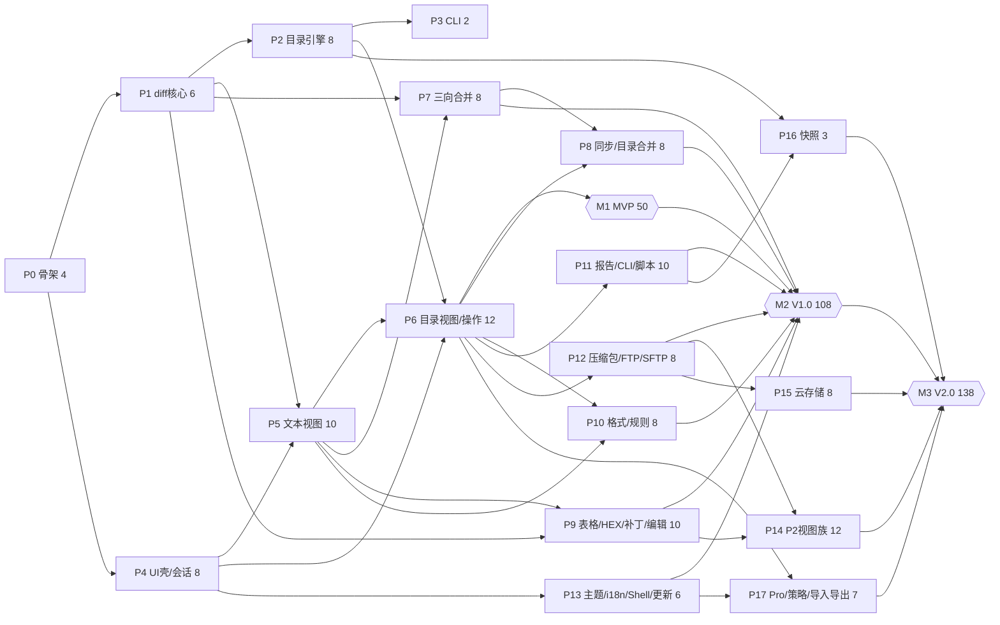

# ai-compare 开发计划

| 项目 | 内容 |
| --- | --- |
| 文档编号 | 04 |
| 项目代号 | ai-compare |
| 文档目的 | 基于《03-架构设计文档》的模块划分（M-xx）与《01-需求规格说明书》的优先级（P0/P1/P2），给出里程碑、阶段拆解、首个可运行切片、测试策略、团队并行度与验收度量 |
| 输入依据 | `01-需求规格说明书.md`（163 个编号需求）、`02-开源竞品与技术调研报告.md`、`03-架构设计文档.md` |
| 编写日期 | 2026-11-13 |
| 编写角色 | 资深软件架构师 |

---

## 目录

1. 总体策略与里程碑规划
2. 阶段拆解
3. 首个可运行切片（Walking Skeleton）
4. 测试策略
5. 团队与并行度建议
6. 度量与验收
7. 计划风险与管理

---

# 1. 总体策略与里程碑规划

## 1.1 总体策略

1. **引擎先行，CLI 验证，UI 随后**（调研报告 6.2-1 的直接推论）：diff 核心与目录扫描在纯 Rust 环境完成并经 CLI 冒烟后，才投入 UI 建设；UI 壳就绪前，引擎已具备可回归测试的能力面。
2. **walking skeleton 贯穿全栈优先**：第 3 节定义的端到端最小闭环在阶段 P0 就打通（进程边界、协议、虚拟滚动、CM6 对齐层四大技术风险全部前置暴露）。
3. **视图插件逐个接入**：UI 壳与视图插件注册表（架构 3.4.2）就绪后，每阶段接入 1~3 个视图插件，每阶段出口都有"可演示的用户故事"。
4. **P2/Pro 不做架构分叉**（架构 ADR-009）：三向合并（Pro）按普通功能排期开发，仅由许可开关门控展示。
5. **性能设施与功能同阶段交付**：每个涉及数据量的阶段同时交付对应 ci-benchmark 场景（架构 8.1 PB 表逐阶段认领），杜绝"事后优化"。

## 1.2 里程碑总表

| 里程碑 | 范围 | 累计工作量（人周，含 15% 管理开销前估算） | 出口判据 |
| --- | --- | --- | --- |
| **M0 Walking Skeleton** | P0 阶段 | 4 | §3 全部验收项通过 |
| **M1 = MVP** | P0 需求全部（SRS 6.3 五条） | 50（M0 计入） | §1.3 全部用户故事可演示 |
| **M2 = V1.0** | P0 + P1 | 108（MVP + 58） | §1.4 全部用户故事 + PB 表达标 |
| **M3 = V2.0** | P0 + P1 + P2/Pro | 138（+ 30） | §1.5 全部用户故事 |

> 工作量按"一名熟练 Rust/TS 工程师满负荷"计；日历时间见 §1.6 排期示例。总量 138 人周 ≈ 2.7 人年——对照 BC 二十余年产品史与调研报告"无开源竞品达到该完整度"的结论，此量级是诚实的。

## 1.3 MVP（M1）验收标准——可演示用户故事

以下 10 个故事逐条现场演示（或以录制视频 + 自动化 e2e 复现）：

| # | 用户故事 | 覆盖 FR（代表） |
| --- | --- | --- |
| S1 | 我选择两个本地文件夹，3 秒内看到并排树状比较，颜色语义正确（黑同/紫孤立/红新/灰未知），后台扫描渐进着色 | DIR-001/002/040 |
| S2 | 我输入名称过滤器 `-*.log;-.git/`，视图即时收敛；切换显示过滤器"只显示差异" | DIR-031/033、FLT-001/002 |
| S3 | 我选中差异文件按 Ctrl+R 复制到右侧，确认对话框出现，复制后行变黑 | DIR-060、OP-001/002 |
| S4 | 我双击一个文本文件，1 秒内看到行级差异（红/蓝）与行内差异高亮，双栏同步滚动 | DIR-070、TXT-001 |
| S5 | 我在左侧直接编辑文本，回比较视图差异实时更新（编辑即重 diff），Ctrl+Z 可撤销，保存后父目录行颜色更新 | TXT-020、UNDO-001、DIR-070 |
| S6 | 我在会话设置里勾选"忽略行尾与行首空白、注释不重要"，差异列表立即收敛为重要差异 | TXT-010、FMT（最小子集） |
| S7 | 我 Ctrl+F 查找并替换（含正则），"下一个差异"三级导航（行内/部分/文件）工作正常 | TXT-022、TXT-030、FIND-001 |
| S8 | 我把比较另存为命名会话"每日构建对比"，重启应用后从主页会话树一键恢复（含过滤器和显示状态） | SES-001/003、HOME-001/002、SET-001 |
| S9 | 我在终端运行 `aic quick a.bin b.bin`，得到退出码 1/11；运行 `aic diff a.c old.c` 得到控制台 unified 输出 | CLI-002/003/004（子集） |
| S10 | 打开的 GB 级文件用十六进制兜底视图可浏览（快速对齐）；10 万项目录滚动不掉帧 | BIG-001、HEX-002（子集）、NFR-PERF |

MVP 明确不含（对齐 SRS 6.2 的 P1/P2 划分）：三向合并、表格/图片/媒体/注册表/版本视图、报告、脚本全集、远程 VFS、压缩包、Shell 集成、快照。

## 1.4 V1.0（M2）验收标准——增量用户故事

| # | 用户故事 | 覆盖 FR（代表） |
| --- | --- | --- |
| S11 | 我以 VCS 冲突场景打开三个文件，输出窗格自动合并非冲突更改；我逐块"取左侧/取右侧"，清除冲突后保存，无冲突退出码 0 | TMRG-001~006 |
| S12 | 我用"镜像到右侧"同步两个文件夹：先看到逐项操作预览（图标），可逐项改写，执行后日志面板完整 | SYNC-001~005 |
| S13 | 我比较两个 CSV：指定键列后行按键对齐，数值容差内的差异显示为蓝色不重要 | TBL-001~003 |
| S14 | 我打开 .patch 文件直接看到重建的并排差异，可逐 hunk 导航 | PATCH-001/011 |
| S15 | 我为目录比较生成 HTML 报告（含列选择与只显示差异），为文本对生成 unified 补丁并 `git apply` 验证可应用 | RPT-001/002、PATCH-010 |
| S16 | 我写 5 行脚本 `load /a /b` → `filter *.txt` → `select newer.files` → `copy left->right` → `folder-report ...`，挂计划任务夜间运行，退出码正确 | SCR-001/002（核心命令）、CLI |
| S17 | 我双击 zip 内文件进入比较，可把文件复制进/出压缩包 | VFS-003（zip 读写） |
| S18 | 我建 SFTP profile 比较远程目录与本地目录，操作照常（进度可取消） | VFS-001/002 |
| S19 | 我切换深色主题（跟随系统），差异配色自动映射；界面中英文切换无需重启 | UI-001、NFR-USE |
| S20 | 我在资源管理器/Finder 右键"比较"，或在主页拖放两文件夹启动比较 | SH-001/002 |
| S21 | 我自定义"下一个差异部分"的快捷键并导出键位配置 | UI-003/004 |
| S22 | 文件复制大批量时可暂停/恢复后台操作 | OP-003 |

## 1.5 V2.0（M3）验收标准——增量用户故事

| # | 用户故事 | 覆盖 FR（代表） |
| --- | --- | --- |
| S23 | 我比较两张 PNG：容差模式下 ≤ 容差像素显示蓝色，可旋转/翻转/拖偏移对齐 | PIX-001~004 |
| S24 | 我比较两个 exe 的版本资源字段，字段重要性可标记 | VER-001/002 |
| S25 | （Windows）我比较本机实时注册表与 .reg 导出，可双向复制键值 | REG-001~003 |
| S26 | 剪贴板托盘工具记录历史，Ctrl+Alt+C 比较最近两条 | CLIP-001~004 |
| S27 | 我把 /data 全盘保存为 3MB 快照，一个月后与实时目录比较（含 CRC 校验损坏检测） | SNAP-001/002 |
| S28 | 我配置 OneDrive/S3 profile，比较云端文件夹与本地 | VFS-002/002b |
| S29 | 我用对齐覆盖让 `*.gif` 与 `*.png` 对齐比较；定义替换 apple↔orange 为不重要（Pro 特性全开演示） | DIR-023、TXT-012 |
| S30 | 管理员下发策略文件禁用远程 profile 与保存密码；我从 BC 导入 BCSessions.xml 会话树 | SET-002/003 |

## 1.6 排期示例（3 人团队，2026-11-16 启动）

| 里程碑 | 理想工期 | 含协调开销（+25%） | 预计达成 |
| --- | --- | --- | --- |
| M0 Walking Skeleton | 2 周 | 2.5 周 | 2026-12 初 |
| M1 MVP | 50/3 ≈ 17 周 | ~21 周 | 2027-04 |
| M2 V1.0 | 58/3 ≈ 19 周 | ~24 周 | 2027-10 |
| M3 V2.0 | 30/3 = 10 周 | ~13 周 | 2028-01 |

单人场景日历见 §5.1。所有日期为规划基线，双周滚动重估。

---

# 2. 阶段拆解

> 阶段编号 P0~P17；模块编号对齐架构文档 §3（M-xx）。每阶段：目标 / FR 覆盖 / 交付物 / 依赖 / 验收测试要点 / 工作量（人周）。

## P0 基础设施与 Walking Skeleton（4 人周）

| 项 | 内容 |
| --- | --- |
| 目标 | monorepo 骨架、CI 三平台、协议契约管线、§3 端到端闭环（降级参数集） |
| FR 覆盖 | 无完整 FR（为全部 FR 铺路）；对齐 CLI-002 子集 |
| 交付物 | ① workspace + ui 脚手架 + cargo-deny + license-audit；② `ai-protocol` 最小方法集 + ts-rs 生成管线；③ `ai-core` 标准对齐（固定选项）；④ `ai-vfs` 本地只读；⑤ `ai-dir` 顶层扫描+按名对齐+size/mtime 快速测试+二进制判等；⑥ `ai-engine --stdio` + dir/delta、text/sections 最小集；⑦ `aic diff`（unified 控制台输出）与 `aic quick`（退出码）；⑧ Tauri 壳 spawn 引擎 + 目录视图（窗口取行）+ 文本视图（CM6 对齐层 + 行内高亮）+ 双击打开子会话；⑨ 首个 golden 用例 + 协议录制回放测试 + PB-04 冒烟基准 |
| 依赖 | 无 |
| 验收测试要点 | §3.4 验收清单全过；`aic diff` 与 `diff -u` 补丁应用等价（对拍）；三平台 CI 绿 |
| 工作量 | 4 人周 |

## P1 diff 核心完备化（6 人周）

| 项 | 内容 |
| --- | --- |
| 目标 | M01 达到 FR-TXT-011 全算法矩阵 + 重要性模型 + 增量重算 |
| FR 覆盖 | TXT-010、TXT-011、TBL-004（行对齐算法复用）、BIG-001（渐进/裁剪管线） |
| 交付物 | Myers/Patience/Histogram 算法接入（imara-diff）与 Standard 渐进流；偏斜容差、接近度匹配、"从不对齐差异"；重要性规范化双键（raw/importance）；手动对齐/隔离锚点；编辑增量重 diff（imara 历史）；行内 diff（词/字符级 + 超时降级 + DMP 语义清理策略）；对拍测试矩阵（difflib/git diff） |
| 依赖 | P0 |
| 验收测试要点 | 算法切换 golden 快照逐个固化；4 种算法在 20 万行语料的耗时入 PB 报表；编辑 1 字符的增量重算只触发受影响 section（断言事件范围） |
| 工作量 | 6 人周 |

## P2 目录引擎完备化（8 人周）

| 项 | 内容 |
| --- | --- |
| 目标 | M03 达到文件夹比较 P0 全量 + 同步/合并状态机数据层 |
| FR 覆盖 | DIR-001~013、DIR-020~022、DIR-030~036、DIR-040~043、DIR-050、SYNC-002（状态机）、DMRG-003（状态机数据层）、FLT-001/002 |
| 交付物 | 惰性+后台扫描（ADR-004 并发模型、取消、进度）；聚合状态增量上推；快速测试全集（秒容差/DST/时区/大小写/属性/Unix 元数据）；CRC（惰性+缓存+zip 预计算）与"快速相同跳过/覆盖快速结果"；手动对齐与平铺模式；三类过滤器引擎侧求值（掩码语义全集含相对掩码）；列数据源（懒加载）；SQLite stat/hash 缓存；同步 5 预设状态机 + 合并状态机（数据层）；10 万项 corpora 生成器 |
| 依赖 | P1（规则判等接口在 P10 前以二进制判等占位） |
| 验收测试要点 | 10 万项目录扫描 PB-03/10 达标；过滤器语义单测覆盖 SRS 4.4 全表（含 `*.`、`[[]`、`.../f` 边角）；缓存命中与失效用例；取消后无悬挂任务（tokio 任务泄漏断言） |
| 工作量 | 8 人周 |

## P3 CLI 最小验证（2 人周）

| 项 | 内容 |
| --- | --- |
| 目标 | 引擎能力经 CLI 固化为可回归面，锁定协议契约 |
| FR 覆盖 | CLI-001（aic/aicc 双形态）、CLI-002、CLI-003（`-fv`/`-qc`/`-filters`/`-ro`/`-title` 子集）、CLI-004（退出码全集） |
| 交付物 | `aic quick`（size/crc/binary/rules 四模式）、`aic diff`（文本统一输出）、`aicc` 等待型包装（VCS difftool 演示：git config difftool 指向）；退出码 0/1/2/11/12/13/14；`--record` 协议录制 |
| 依赖 | P1、P2 |
| 验收测试要点 | git difftool/mergetool 集成冒烟脚本（S9）；退出码矩阵单测；CI 无 GUI 环境（headless）全跑通 |
| 工作量 | 2 人周 |

## P4 UI 壳与会话体系（8 人周）

| 项 | 内容 |
| --- | --- |
| 目标 | M30 应用壳 + M06 会话层 + 视图插件注册表可用 |
| FR 覆盖 | HOME-001/002、SES-001~006、WIN-001/002（标签页）、SET-001（持久化+.bak+便携模式）、UI-005 |
| 交付物 | 主页视图（类型大按钮、会话树面板、最近会话、拖放）；窗口/标签页管理（拖出标签、合并窗口）；会话保存/另存/锁定/作用域下拉四选项；sessions.json/state.json 读写 + 原子写 + .bak + MRU；ViewRegistry + ViewCtx + 命令注册表骨架 + 快捷键引擎（默认 BC 键位）；设置对话框框架（schema 表单 + 分页导航）；rev 同步/断线重连封装 |
| 依赖 | P0（协议）、P2（会话设置结构） |
| 验收测试要点 | S8 端到端 e2e；作用域合并单测（同键四层覆盖优先级）；会话文件损坏→自动回滚 .bak 并提示（R12 演练）；标签页 UI 组件测试 |
| 工作量 | 8 人周 |

## P5 文本比较视图完备化（10 人周）

| 项 | 内容 |
| --- | --- |
| 目标 | M32 达到 FR-TXT P0 全量；FR-TXT P1 中不依赖格式系统的部分 |
| FR 覆盖 | TXT-001~004、TXT-013/014（格式探测简化版）、TXT-020~023、TXT-030、FIND-001、UNDO-001、ENC-001、EDIT-001（单窗格编辑器复用同内核） |
| 交付物 | gutter/缩略图/概览导航；行详情三模式（文本/十六进制/对齐）；可见空白/行号/标尺/语法高亮（Shiki 基础语言包）/自动换行；显示过滤器（全部/差异/相同/上下文 N 行/隐藏行计数/忽略不重要/忽略）；查找替换面板（正则辅助插入、全选匹配行、循环、侧）；书签；差异导航三级 + "复制并打开下一个差异"；复制到对侧（行/部分）；转换文件（空白/制表/行尾）；编码检测链 + 手动覆盖重载；保存/另存/备份选项；剪贴板打开（CLIP-004 子集）；编辑禁用条件全集（只读 VFS/转换不可存/父会话禁用） |
| 依赖 | P1、P4 |
| 验收测试要点 | S4~S7 e2e；PB-05/07/08 基准（10MB 文件打开、编辑重 diff、行内懒算）；CM6 对齐层组件测试（占位行/三窗格同步/换行模式下的对齐保持，R10 专项）；编码 corpora（UTF-8/16/GBK/Big5/Shift-JIS/BOM 变体）golden |
| 工作量 | 10 人周 |

## P6 文件夹比较视图与文件操作（12 人周）

| 项 | 内容 |
| --- | --- |
| 目标 | M33 + M10 达到文件夹比较 P0 全量，MVP 出口 |
| FR 覆盖 | DIR-001~068（P0 部分）的全 UI 化：DIR-050 选择模型、DIR-060~068 操作、DIR-070~072 子会话/回传、OP-001/002、DIR-013 快速比较对话框 |
| 交付物 | 虚拟树表（10 万项、展开缓存、排序、列体系懒值）；选择模型（中间列/Ctrl/Shift 侧限制/空格标记/选择较新孤立等命令）；文件操作队列（复制到对侧/到文件夹三路径策略、移动、交换、删除回收站、重命名 DOS+正则、属性对话框三态、touch、新建文件夹/压缩包、复制文件名、排除、刷新三档）+ 确认体系 + 后台暂停；操作遵循过滤器语义；子会话差异文件导航（下一个差异文件/复制并打开下一个）；差异回传着色端到端；图标/图例/彩色点；基文件夹导航（后退前进/上一级/交换侧/设为基）；快速比较对话框 |
| 依赖 | P2、P4、P5（子会话打开依赖文本视图） |
| 验收测试要点 | S1~S3、S5、S10 e2e；PB-02/03/04/11/13 达标；文件操作 dry-run 单测（文件夹=过滤后内容、父与子同选忽略父）；跨平台权限/属性列（Windows ACL 与 Unix mode）平台适配测试 |
| 工作量 | 12 人周 |

> **M1（MVP）出口评审**：§1.3 S1~S10 全演示 + PB 表 MVP 行达标 + e2e 套件三平台绿。

## P7 三向文本合并（8 人周）

| 项 | 内容 |
| --- | --- |
| 目标 | M02 + text-merge 视图（Pro 门控开发、默认全开演示） |
| FR 覆盖 | TMRG-001~007、CLI-003（/automerge /force /reviewconflicts /favorleft /center= /mergeoutput=） |
| 交付物 | diff3 块图合成（冲突分类 + N 行分隔冲突窗口配置）；自动合并输出 + take 命令族（部分/行/先左后右）；输出编辑（黄块）+ 冲突清除/设置；合并显示过滤器；分离输出窗格；输出保存（覆盖警告 + 备份）；`/automerge` 无头路径（CLI 退出码 0/14/101）；冲突导航 |
| 依赖 | P1、P5 |
| 验收测试要点 | S11 e2e；冲突语料 golden（modify-modify/delete-modify/add-add/相同更改）；与 git merge-file 对拍（仅断言结果应用等价与冲突块集合，不断言文本逐字相同）；N 行分隔冲突窗口行为单测 |
| 工作量 | 8 人周 |

## P8 文件夹同步与文件夹合并（8 人周）

| 项 | 内容 |
| --- | --- |
| 目标 | folder-sync / folder-merge 视图 + SYNC/DMRG 全量 |
| FR 覆盖 | SYNC-001~006、DMRG-001~004 |
| 交付物 | 同步专用界面（方法下拉/预览列表/接受/立即同步/日志面板）；逐项操作改写（保持不变/复制/删除）；自定义同步方法；同步设置页（空文件夹/压缩包内同步/回收站）；文件夹合并视图（三窗格 + 合并目标四选 + 取左中右/复制到输出 + 自动合并调用 P7）；DMRG 颜色语义 |
| 依赖 | P6、P7 |
| 验收测试要点 | S12 e2e；5 预设 × 若干目录形态（含孤立项/冲突项/空文件夹开关）的期望操作表 golden；合并自动触发文本合并（可 merge 文件）与非文本（直接复制）分流测试 |
| 工作量 | 8 人周 |

## P9 表格 / 十六进制 / 补丁 / 编辑视图（10 人周）

| 项 | 内容 |
| --- | --- |
| 目标 | M09a/b/g 视图 + EDIT 全量 |
| FR 覆盖 | TBL-001~006、HEX-001~003、PATCH-001、EDIT-001、FIND-003 |
| 交付物 | 表格：CSV/TSV/HTML/Excel 多工作表、比较列/键列/列类型容差、工作表选项卡对齐、沟槽点、单元格复制；十六进制：canvas 自绘虚拟网格、三种对齐、内联编辑重比较、查找替换（文本/十六进制模式）、字节地址/端序；补丁视图：normal/context/unified 解析重建并排视图（只读导航全集）；文本编辑视图：在文件中查找（FR-FIND-003）、单窗格全功能 |
| 依赖 | P5（编辑内核/查找复用）、P1（表格行对齐） |
| 验收测试要点 | S13、S14 e2e；CSV 边角语料（引号/换行嵌套/BOM/大单元格/多 sheet）；HEX 编辑撤销与保存往返字节一致；patch 解析器对 git/diff -u/diff -c 三格式 corpora 解析 golden |
| 工作量 | 10 人周 |

## P10 文件格式与规则体系（8 人周）

| 项 | 内容 |
| --- | --- |
| 目标 | M05 全量：格式列表/语法元素/转换/基于规则比较落地 |
| FR 覆盖 | FMT-001~005、SEL-001、DIR-011（基于规则比较）、TXT-012（替换，P2 提前到本阶段一并实现引擎侧）、ENC-001（代码页覆盖） |
| 交付物 | 格式管理 UI（有序列表/遮蔽红显/启用/会话覆盖关联）；语法元素五类编辑器（文本/分隔/列表/列/行-页标题）+ 行权重 + 制表位 + 行独立/列数据标志；内置常见语言语法包（C/C++/Java/JS/TS/Python/Go/Rust/SQL/Shell/XML/JSON ≥ 12 种，参考 TextMate 语法转译为内部模型）；转换例程（外部程序 %s/%t/%o + 退出码校验；PDF→文本内置）；基于规则的目录内容比较（判定四态：二进制同/规则同/不重要差异/重要差异）接入 P2 接口；替换（Pro）引擎与设置 UI |
| 依赖 | P1、P5、P6 |
| 验收测试要点 | 语法元素解析 golden（每类元素 × 正则/转义/大小写矩阵）；"忽略注释差异后判定规则相同"端到端（C 文件 corpora）；格式遮蔽与覆盖关联单测；外部转换程序沙箱冒烟（超时/非零退出/空产物） |
| 工作量 | 8 人周 |

## P11 报告 + CLI 全集 + 脚本处理器（10 人周）

| 项 | 内容 |
| --- | --- |
| 目标 | M07 + M08 全量（自动化能力面） |
| FR 覆盖 | RPT-001/002 全表、PATCH-010、CLI-001~004 全集、SCR-001~003（31 命令分期：本期交付除 SNAPSHOT/ATTRIB/TOUCH/RENAME 之外的全部；SNAPSHOT 在 P16） |
| 交付物 | 报告框架（布局×选项×目标矩阵、HTML 着色/自定义样式表/剪贴板/打印预览、统计 CSV、XML、include-file-links）；补丁三格式；脚本运行器（文法全集：%n/%VAR%/%date%/&续行/大小写不敏感；不可见会话模型 SELECT/FILTER/EXPAND；LOG/OPTION；状态窗口与 /silent）；全部 *-REPORT 脚本命令；CLI 开关全集补齐 |
| 依赖 | P6~P10（各视图会话模型就绪才有对应报告） |
| 验收测试要点 | S15、S16 e2e；报告 golden（归一化 HTML/文本，跨平台换行归一）；31 命令逐一参数矩阵单测（对齐 SRS FR-SCR-002 规格）；脚本错误路径退出码 105/106/107；`aic @script` 在 CI 无头环境跑通 |
| 工作量 | 10 人周 |

## P12 VFS 扩展：压缩包 + FTP/SFTP（8 人周）

| 项 | 内容 |
| --- | --- |
| 目标 | M04 远程与压缩包能力（V1.0 范围） |
| FR 覆盖 | VFS-003（zip 读写 + 7z/tar/gz 等读取长尾渐进）、VFS-001/002/002a（FTP/FTPS/SFTP profile 六页设置核心项） |
| 交付物 | libarchive 压缩包 VFS（读写能力协商、掩码配置页、复制进/出包、创建包）；FTP/FTPS 自研（suppaftp：被动/限端口/ASCII-binary 自动/MODE Z/列表协商 MLSD/-a/-T、编码与时区）；SFTP（rclone 或 ssh2 评估后定）；profile 管理 UI + 凭据 keychain；连接数与超时配置 |
| 依赖 | P6（操作走 VFS ops） |
| 验收测试要点 | S17、S18 e2e（本地 docker vsftpd/openssh-server 测试容器）；压缩包 corpora（zip/7z/tar/tar.gz/tbz2/xz/cab/rar 只读）golden；FTP 边角（列表格式变体语料、断线重试、带宽限制生效）；凭据不落盘断言（策略开启时） |
| 工作量 | 8 人周 |

## P13 主题 / i18n / 快捷键 / Shell 集成 / 自动更新（6 人周）

| 项 | 内容 |
| --- | --- |
| 目标 | V1.0 收口件 |
| FR 覆盖 | UI-001~006、NFR-USE（中英）、SH-001/002、SET-004、UI 快捷键自定义全量 |
| 交付物 | 浅/深/跟随系统主题 + 差异配色自定义（预览模式）+ 图例窗口；三类字体设置与即时缩放；i18n 全量词条（zh/en）+ 伪本地化 CI；命令/工具栏自定义 UI（附录 F 命令矩阵逐视图核对）；Windows 右键菜单（含 Win11 风格）/macOS Finder 扩展/Linux 文件管理器集成；拖放全域；Tauri updater + 更新检查策略 |
| 依赖 | P4~P12 |
| 验收测试要点 | S19~S21 e2e；主题切换无闪烁快照测试；i18n 键完整性门禁；三平台 Shell 集成手工矩阵（含卸载清理）；更新回滚演练 |
| 工作量 | 6 人周 |

> **M2（V1.0）出口评审**：§1.4 S11~S22 全演示 + PB 表全量达标 + 三平台安装包（签名）产出 + 首个公测版本。

## P14 P2 视图族：图片 / 媒体 / 版本 / 注册表 / 剪贴板（12 人周）

| 项 | 内容 |
| --- | --- |
| 目标 | M09c/d/e/f + CLIP |
| FR 覆盖 | PIX-001~004、MED-001/002、VER-001/002、REG-001~003、CLIP-001~004 |
| 交付物 | 图片比较（解码/容差三模式/旋转翻转/偏移拖拽/像素取色/棋盘透明/缩放）；媒体比较（标签解析 + 单/双轨播放）；版本比较（PE 资源 + MUI；字段重要性）；注册表比较（仅 Windows：reg:// 实时 + .reg，可编辑）；剪贴板后台工具（托盘/全局快捷键/存储限制/另存为） |
| 依赖 | P9（视图基座）、P12（VFS 注册表分支） |
| 验收测试要点 | S23~S26 e2e；图片几何对齐后差异稳定性 golden（旋转 90° 后同图应零差异）；媒体标签 corpora（ID3v1/v2/Vorbis/MP4 atom）；PE 版本资源 corpora（多语言资源/无版本段）；注册表写回在 CI 快照 VM 回滚执行 |
| 工作量 | 12 人周 |

## P15 云存储 / SVN / MTP（8 人周）

| 项 | 内容 |
| --- | --- |
| 目标 | rclone sidecar 全量接入 |
| FR 覆盖 | VFS-001/002/002b（WebDAV/S3/Dropbox/OneDrive/SVN@rev/MTP/HTTP） |
| 交付物 | rclone sidecar 生命周期管理（按需拉起/端口 token/版本锁定/可选组件下载器）；profile UI（OAuth 授权流/S3 凭据三来源/命名桶）；WebDAV 递归列表；svn+http/ssh 桥接与 @rev 寻址；MTP（rclone 后端能力边界文档化，不足处明示限制） |
| 依赖 | P12 |
| 验收测试要点 | S28 e2e（测试容器：MinIO/S3、本地 WebDAV、 Dropbox/OneDrive 沙箱账号）；sidecar 崩溃自动重启与连接复用；凭据 keychain + 策略禁存回归 |
| 工作量 | 8 人周 |

## P16 快照（3 人周）

| 项 | 内容 |
| --- | --- |
| 目标 | .aicss 全量 |
| FR 覆盖 | SNAP-001/002、SCR（SNAPSHOT 命令）、BIG-001（整盘快照） |
| 交付物 | .aicss 读写 VFS（zstd JSON 行流）；保存选项全集（save-crc/save-version/expand-archives/include-empty/follow-symlinks/no-filters）；记住源基文件夹的自动配对；SNAPSHOT 脚本命令；.bcss 尽力导入器（标注不确定性） |
| 依赖 | P2、P11 |
| 验收测试要点 | S27 e2e；100 万项整盘快照体积/耗时基准（< 60s / < 100MB 含 CRC 抽样断言）；快照↔快照、快照↔实时双方向 golden |
| 工作量 | 3 人周 |

## P17 Pro 特性收口 / 管理策略 / 导入导出（7 人周）

| 项 | 内容 |
| --- | --- |
| 目标 | 对齐覆盖、SCC、策略、设置包、BC 会话导入；V2.0 出口 |
| FR 覆盖 | DIR-023（对齐覆盖）、DIR-066 SCC 子菜单、SET-002/003/005/006/007、SES-005（共享会话包 .aipkg）、ADR-010 兼容承诺 |
| 交付物 | 对齐覆盖 UI（掩码/正则替换式/限制文件夹）；SCC 集成（MSSCCI 桥，仅 Windows，评估开源提供程序）；打开方式应用程序体系（%f/%l/%n 变量族）；.aipkg 设置包导出/导入（同名红色警示）；BCSessions.xml 只读导入；管理策略三开关（注册表/配置文件）+ 便携模式完善；许可框架（试用/密钥/UI 门控） |
| 依赖 | P6、P13、P16 |
| 验收测试要点 | S29、S30 e2e；导入导出往返（导出→清空→导入→会话树逐字段等价断言）；策略在 Windows 域环境冒烟 |
| 工作量 | 7 人周 |

> **M3（V2.0）出口评审**：§1.5 S23~S30 + FR 追溯矩阵（§6.3）无缺口 + 全部 163 需求终验。

## 2.x 阶段依赖图与工作量汇总

| 里程碑 | 阶段 | 工作量（人周） |
| --- | --- | --- |
| M0 | P0 | 4 |
| M1 MVP | P0~P6 | 50 |
| M2 V1.0 | P7~P13 | +58（累计 108） |
| M3 V2.0 | P14~P17 | +30（累计 138） |

---

# 3. 首个可运行切片（Walking Skeleton）详细定义

## 3.1 端到端最小闭环（一句话）

**选两个本地文件夹 → 目录比较（树状、快速测试判等）→ 双击其中一个 .c/.txt 文件 → 行级 + 行内 diff → 双窗格展示与同步滚动 → 关闭后父目录该行按内容差异着色。**

不在范围内（显式排除）：编辑/保存、过滤器、会话保存、取消、报告、编码检测（仅 UTF-8/UTF-8-BOM）、多算法（仅 Standard）、排序/列配置、撤销。

## 3.2 涉及的全部模块（架构 §3 映射）

| 层 | 模块 | 本切片实现范围 |
| --- | --- | --- |
| 引擎 | M23 ai-protocol | `initialize` / `dir/open` / `dir/delta` / `dir/rows` / `dir/openChild` / `text/sections` / `text/lines` / `text/inlineDiff` / `session/close` + 错误码 + ts 生成 |
| 引擎 | M01 ai-core | Standard 对齐（分块渐进）+ 行内词级 diff（无重要性开关、无锚点、无增量） |
| 引擎 | M04 ai-vfs | 本地 FS 只读：list/stat/open(mmap) |
| 引擎 | M03 ai-dir | 顶层+一级扫描（同步完成即返回首屏）、按名对齐、size/mtime 快速测试、二进制逐字节判等 |
| 引擎 | M05 ai-formats | 仅扩展名嗅探：文本（.txt/.c/.h/.md/.json/.xml...）vs 十六进制兜底 |
| 引擎 | M22 ai-engine | stdio NDJSON JSON-RPC server + 会话表 + 事件扇出 + `--record` |
| CLI | aic | `aic diff <file1> <file2>`（控制台 unified 输出）、`aic quick <f1> <f2>`（退出码 0/1/11）、`aic engine --echo`（协议自检） |
| UI | M30 壳 | Tauri 窗口 + 引擎 spawn/重启重连 + 单视图路由（无标签页） |
| UI | M31 folder-compare | 最小树表（仅名称/状态两列 + 彩色点）+ 窗口取行 + 双击事件 |
| UI | M32 对齐文本视图 | CM6 双窗格、对齐占位空行、gutter 着色、可视区行内高亮、按 section 锚同步滚动 |
| UI | M33 虚拟列表 | 5 万行级窗口渲染（10 万项为 P2 目标） |
| 测试 | golden/bench | 1 组目录对 + 1 组文本对 golden；PB-04 冒烟（5 万行滚动帧率） |

## 3.3 任务清单（16 项，括号为估工人日）

**引擎线（E）**
- E1 workspace 脚手架 + cargo-deny + CI 三平台矩阵（2）
- E2 ai-protocol 类型 + ts-rs 生成 + 协议文档生成（3）
- E3 ai-core：行哈希管线 + similar/imara 接入 Standard 渐进 + section 流（5）
- E4 ai-core：行内词级 diff（含超时）+ 单测对拍 difflib（3）
- E5 ai-vfs 本地只读 + mmap LineIndex（3）
- E6 ai-dir：扫描+对齐+快速测试+二进制判等 + 首版 DirDelta（5）
- E7 ai-engine：RPC server + 分发 + 事件扇出 + record（5）
- E8 aic CLI 三命令（2）

**UI 线（U）**
- U1 Tauri + React 脚手架 + 引擎 spawn/重连 + ipc 封装（3）
- U2 文本视图：CM6 集成 + 对齐占位层 + gutter + 同步滚动（8）← **R10 风险主验证项**
- U3 文本视图：可视区行内高亮懒取 + 概览条雏形（3）
- U4 目录视图：窗口化树表 + 状态着色 + 双击打开子会话（5）
- U5 主页最小入口（两路径选择框 + Go）（1）

**测试线（T）**
- T1 golden 语料 + 快照对比 runner（2）
- T2 协议录制回放测试 + e2e 冒烟（tauri-driver：打开→双击→断言行内高亮存在）（4）

合计 ≈ 54 人日 ≈ **4 人周**（与 P0 预算一致；2 人并行约 2.5 周日历）。

## 3.4 Walking Skeleton 验收清单（M0 出口判据）

1. `aic diff a.c b.c` 输出与 `diff -u` 在"补丁应用等价"意义下一致（对拍脚本）。
2. `aic quick same.bin same2.bin` 退出码 1；不同则 11。
3. GUI：选两个含 200 文件/6 子目录的语料文件夹，3 秒内出树，双击 .c 文件 1 秒内出双窗格行级+行内差异，滚动同步。
4. 关闭文本子视图后，父目录该行呈现内容差异着色（回传链路）。
5. `--record` 产物可直接喂给 `ai-engine --replay` 得到相同终态（协议确定性）。
6. 5 万行文件滚动 ≥ 45fps（最低线），10MB 文本打开 < 2s（P0 放宽线，PB 正式线在 P5 达标）。
7. 三平台（macOS arm64 / Windows x64 / Linux x64）CI 全绿，产出可运行安装包骨架。

---

# 4. 测试策略

## 4.1 测试分层总表

| 层 | 对象 | 工具 | 时机 | 通过标准 |
| --- | --- | --- | --- | --- |
| L1 单元 | 各引擎 crate 纯函数（掩码匹配/规范化键/块合成/状态机/脚本解析） | cargo test + proptest | 每次 commit | ai-core/ai-dir ≥ 85% 语句覆盖；性质测试（diff 对称性/补丁往返/section 区间连续覆盖）1000 轮无反例 |
| L2 属性/对拍 | diff 算法族 | proptest + difflib/git 对拍 | 每次 commit | 输出补丁可应用且还原原文；与 git diff 的冲突仅限等价 hunk 划分差异（白名单比对器） |
| L3 协议 | RPC 方法 + 事件流 | in-process server + NDJSON 回放 fixture | 每次 commit | 全方法矩阵（参数合法/非法/rev 冲突/取消/超时）断言；录制回放终态一致 |
| L4 集成（引擎级 golden） | 真实目录树与文件对的比较全结果 | corpora runner（xtask） | 每次 commit / 每晚全量 | JSON 摘要 + 归一化 HTML 与 `tests/golden` 快照逐字节一致；更新快照必须 `bless` 显式提交 |
| L5 UI 组件 | M32/M33/M34 关键组件 | Vitest + Testing Library | 每次 commit | 对齐占位/同步滚动/过滤切换/主题映射组件测试 |
| L6 e2e | 端到端用户故事（S1~S30 映射） | tauri-driver（Win/Linux）+ XCUITest 桥（macOS）或 Playwright over CDP | 每夜 + 发布前 | 里程碑用户故事全部自动化复现 |
| L7 性能基准 | PB-01~14 | criterion（微）+ 场景基准（宏）+ ci-benchmark workflow | 每夜 + 每里程碑 | PB 表全部绿；较上一里程碑回归 > 10% 报警 |

## 4.2 golden 语料（tests/corpora）

固定随机种子生成 + 手工锚定用例，纳入仓库（LFS）：

| 语料族 | 内容 | 用途 |
| --- | --- | --- |
| dir-small / dir-10k / dir-100k | 生成目录树（可控：孤立率/新/旧/同/压缩包/符号链接/大小分布） | 目录扫描/对齐/过滤/报告 golden 与 PB-02/03 |
| text-*.c/.py/.json/... | 200 对真实风格文件（含：仅空白差/仅注释差/重排/编码变体/行尾变体/超长行/大段重复） | diff 算法与重要性 golden |
| merge-conflict 家族 | modify-modify / delete-modify / add-add / 相同更改 / N 行邻近 | diff3 golden |
| csv / xlsx / html-table | 引号/多行单元格/BOM/多 sheet | 表格 golden |
| patch 家族 | git/diff -u/diff -c/normal 输出各 20 份 | 补丁解析 golden |
| archive 家族 | zip/7z/tar/tbz2/xz/cab/rar（只读）含嵌套 | VFS golden |
| encoding 家族 | UTF-8/16LE/BE/BOM×/GBK/Big5/Shift-JIS/EBCDIC 样本 | 编码检测 golden |

## 4.3 性能基准（ci-benchmark）

- 每夜跑 PB-01~14 全表（三平台各一 runner），结果写入内部看板并附 PR 注释（指定 label 触发）。
- criterion 微基准：行 diff 吞吐、行内 diff 单行耗时、掩码匹配吞吐、delta 序列化吞吐。
- 场景宏基准：corpora 驱动的端到端（打开→滚动→过滤→报告），断言 P95/P99。
- 基线管理：每个里程碑冻结一份基线，回归超限阻塞合并（对应 R8/R9）。

## 4.4 特殊测试

- **i18n**：伪本地化（键完整性 + 占位符一致）CI 门禁；zh/en 双语截图冒烟。
- **可访问性**：键盘全遍历冒烟（MVP 起）；读屏标注在 P13 集中补齐。
- **平台差异**：Windows 属性/回收站/注册表用 CI Windows VM 快照回滚；Unix 权限/symlink 用容器矩阵。
- **崩溃注入**：引擎 panic / sidecar 崩溃 / 协议半包 / 磁盘满，验证 UI 降级与会话恢复（R12）。
- **许可审计**：cargo-deny + npm license-check，GPL/AGPL 出现即 fail（R1/R5/R6）。

---

# 5. 团队与并行度建议

## 5.1 单人开发（节奏：串行为主，CLI 先行）

| 阶段 | 建议顺序 | 日历（含 25% 开销） |
| --- | --- | --- |
| M0~M3 | P0 → P1 → P2 → P3 → P4 → P5 → P6（MVP）→ P10 → P7 → P9 → P8 → P11 → P12 → P13（V1.0）→ P16 → P14 → P17 → P15（V2.0） | MVP ≈ 12 个月；V1.0 ≈ 累计 25 个月；V2.0 ≈ 累计 33 个月 |
| 说明 | 单人时把 P10（格式/规则）提前到 P7 前——它对单人"自用价值"提升最大（代码比较质量）；P15 云存储最后做。风险：R11 范围失控，建议单人场景砍掉 P14 全部与 P15（保留 V2.0 = 快照 + Pro 收口） | 调整后 V2.0 ≈ 累计 26 个月 |

## 5.2 双人开发（引擎线 E / UI 线 U）

| 人员 | 主责 | 关键交接契约 |
| --- | --- | --- |
| 工程师 A（Rust 侧重引擎） | E1~E8 全部引擎阶段（P1、P2、P7、P10、P11、P12、P16） | ① ai-protocol 类型（先行合入，UI 以生成包编码）；② corpora/golden runner；③ PB 基准报告 |
| 工程师 B（TS 侧重 UI） | U1~U5 全部 UI 阶段（P4、P5、P6、P8、P9、P13、P14 视图） | ① 协议回放 fixture（B 产出给 A 做引擎回归）；② e2e 用例；③ 组件测试 |
| 共担 | P0 骨架（两人结对 2.5 周）、P3 CLI、P17 | 每双周一次协议契约评审 |

日历：MVP ≈ 7 个月；V1.0 ≈ 累计 15 个月；V2.0 ≈ 累计 20 个月。

## 5.3 三人开发（调研报告推荐阵容形态）

| 人员 | 主责线 | 阶段分配 |
| --- | --- | --- |
| A 引擎核心 | ai-core / ai-dir / ai-diff3 / 性能 | P1、P2、P7（合并算法半）、P16、全阶段 PB 基准 |
| B 引擎集成 | VFS / 格式 / 报告 / 脚本 / CLI / 发布 | P3、P10、P11、P12、P15、P17、CI/CD 与打包签名 |
| C UI | 壳 / 视图插件族 / 主题 i18n / e2e | P4、P5、P6、P8、P9、P13、P14、P17 UI 半 |
| 并行规则 | 协议类型先行合入主干；任何跨线依赖以"生成包 + 回放 fixture"解耦；MVP 前禁止 C 等 A 的完整实现（用协议 stub + 录制数据开发） | — |

日历：见 §1.6（MVP 2027-04 / V1.0 2027-10 / V2.0 2028-01）。

## 5.4 角色与技能要求

- 引擎线：熟练 Rust + tokio；diff 算法背景可通过研读 similar/imara-diff 源码（均为 Apache/MIT，允许）快速获得。
- UI 线：TypeScript/React + CodeMirror 6 扩展开发经验（CM6 是最高学习曲线点，walking skeleton 即上手）。
- 共同：跨平台桌面发布经验（签名/公证）至少一人具备。

---

# 6. 度量与验收

## 6.1 每里程碑 DoD（Definition of Done）

| 维度 | M1 MVP | M2 V1.0 | M3 V2.0 |
| --- | --- | --- | --- |
| 功能 | §1.3 S1~S10 演示通过；P0~P6 交付物齐全 | §1.4 S11~S22；P7~P13 齐全 | §1.5 S23~S30；P14~P17 齐全 |
| 追溯 | P0 级 FR 100% 映射到测试用例（§6.3 矩阵无空格） | + P1 级 100% | 163/163 全覆盖 |
| 测试 | L1~L5 绿；e2e ≥ 10 条；golden ≥ 200 组 | golden ≥ 600 组；e2e ≥ 25 条 | golden ≥ 800 组；e2e ≥ 35 条 |
| 性能 | PB-01~08、10、11、13 达标 | PB 全表达标 + 基线冻结 | PB 全表达标且无 >5% 回归 |
| 工程化 | 三平台 CI + 安装包骨架 + cargo-deny | 三平台签名安装包 + 自动更新 + 崩溃上报 | + 便携模式 + 策略文件 + 许可框架 |
| 文档 | README 快速上手 + 协议文档生成 | 用户手册（对齐 SRS 附录 A 主题结构起步）+ CLI/脚本参考 | 完整帮助（中英）+ BC 迁移指南 |
| 遗留 | 已知问题清单 ≤ 20 且无 P0 级 | ≤ 30 且无 P0/P1 级 | ≤ 40 且无 P0/P1 级 |

## 6.2 性能指标表（验收口径）

以架构文档 §8.1 PB-01~14 为唯一口径；里程碑认领：

| 指标 | MVP 达标线 | V1.0 达标线 | V2.0 达标线 |
| --- | --- | --- | --- |
| PB-02 文件夹首屏（1 万项） | ≤ 1.5s | ≤ 800ms | ≤ 500ms |
| PB-03 十万项全扫描 | ≤ 60s | ≤ 35s | ≤ 20s |
| PB-04 十万项滚动 | ≥ 45fps | ≥ 55fps | ≥ 60fps |
| PB-05 10MB 文本打开 | ≤ 2s | ≤ 1.2s | ≤ 800ms |
| PB-07 编辑重 diff | ≤ 150ms | ≤ 100ms | ≤ 50ms |
| PB-12 十万项 HTML 报告 | — | ≤ 20s | ≤ 5s |
| 其余 PB | 冒烟 | 全达标 | 全达标 |

## 6.3 FR 追溯矩阵（按组汇总；163 项 = 95 会话类 + 61 通用类 + 7 NFR）

| 需求组 | 条数 | 优先级构成 | 里程碑 | 承接阶段 | 承接模块 |
| --- | --- | --- | --- | --- | --- |
| DIR 文件夹比较 | 35 | P0 主体；规则比较/版本列 P1；对齐覆盖/SCC P2 | MVP 主体 + V1.0 补 + V2.0 Pro | P2/P6/P10/P17 | M03、M33、M10 |
| TXT 文本比较 | 14 | P0（Myers/Patience 选项 P1） | MVP | P1/P5/P10 | M01、M05、M32 |
| TMRG 文本合并 | 7 | P1 | V1.0 | P7 | M02、M32 |
| DMRG 文件夹合并 | 4 | P1 | V1.0 | P8 | M03、M31 |
| SYNC 文件夹同步 | 6 | P1 | V1.0 | P8 | M03、M31 |
| TBL 表格比较 | 6 | P1 | V1.0 | P9 | M09a |
| HEX 十六进制比较 | 3 | P1 | V1.0（MVP 快速对齐子集） | P0/P9 | M09b |
| PIX 图片比较 | 4 | P2 | V2.0 | P14 | M09c |
| MED 媒体比较 | 2 | P2 | V2.0 | P14 | M09d |
| REG 注册表比较 | 3 | P2 | V2.0 | P14 | M09f |
| VER 版本比较 | 2 | P2 | V2.0 | P14 | M09e |
| CLIP 剪贴板比较 | 4 | P2 | V2.0 | P14 | 托盘工具 |
| PATCH 文本补丁 | 3 | P1 | V1.0 | P9/P11 | M09g、M07 |
| EDIT 文本编辑 | 1 | P1 | V1.0 | P5/P9 | M32 |
| SEL 自动选型 | 1 | P1（MVP 简化版掩码嗅探） | MVP 简化 + V1.0 全量 | P0/P10 | M05 |
| HOME 主页视图 | 2 | P0 | MVP | P4 | M30 |
| SES 会话管理 | 6 | P0 | MVP | P4 | M06 |
| WIN 窗口/标签/工作区 | 3 | P0（完整配置 P1） | MVP + V1.0 补 | P4/P13 | M30 |
| FLT 掩码语义 | 2 | P0 | MVP | P2 | M03 |
| FMT 文件格式 | 5 | P1 | V1.0 | P10 | M05 |
| RPT 报告 | 2 | P1（XML/统计 P2） | V1.0 + V2.0 补 | P11 | M07 |
| CLI 命令行 | 4 | P1（子集提前） | 子集 MVP + V1.0 全量 | P0/P3/P11 | M08 |
| SCR 脚本 | 3 | P1 核心 + P2 长尾 | V1.0 + V2.0 补 | P11/P16 | M08 |
| VFS 远程/压缩包 | 5 | zip/FTP/SFTP P1；云/SVN/MTP P2 | V1.0 + V2.0 | P12/P15 | M04 |
| SNAP 快照 | 2 | P2 | V2.0 | P16 | M04 |
| OP 文件操作 | 3 | 确认体系 P0；后台 P1 | MVP + V1.0 补 | P6 | M10 |
| UI 外观交互 | 6 | P1（基础着色 MVP 必备） | MVP 基础 + V1.0 全量 | P5/P6/P13 | M34 |
| SET 设置管理 | 8 | 持久化 P0；导入导出/策略 P2 | MVP 1 项 + V2.0 其余 | P4/P17 | M06/M30 |
| SH Shell 集成 | 3 | P1（拖放 MVP） | MVP 拖放 + V1.0 右键 | P0/P13 | M30/M34 |
| UNDO 撤销 | 1 | P1（文本 MVP 即含） | MVP | P5 | M32 |
| FIND 查找 | 4 | 文本查找 P0；其余 P1 | MVP + V1.0 | P5/P9 | M32 |
| ENC 编码 | 1 | P0（覆盖面渐进） | MVP 核心 + V1.0 广 | P5/P10 | M05 |
| BIG 大文件 | 1 | P1 | 分散于 P0~P16 各基准 | 各阶段 | 全栈 |
| NFR（PERF×2/PLAT/LIC/USE/SEC/ROB） | 7 | — | 随里程碑逐项验收 | 全程 | 全栈 |

维护规则：矩阵以脚本从 SRS 提取 FR 编号并与测试用例标签（`FR-XXX-NNN`）双向校验，CI 输出覆盖率报告；里程碑评审以该报告为准（替代逐条人工核对 163 项）。

---

# 7. 计划风险与管理

| # | 计划风险 | 缓解 |
| --- | --- | --- |
| PR1 | 总量 138 人周对个人/小团队过长，中途动力衰减 | 里程碑每 4~6 个月出一个"可日常自用"版本（MVP 即达成日常可用）；walking skeleton 3 周内看到端到端成果 |
| PR2 | CM6 对齐层（R10）返工冲击 P5/P6 | P0 即验证（U2 是最大单项 8 人日）；预留"锚点跳转"降级方案；若两周内无法达成同步滚动，升级为架构评审（考虑自绘 canvas 文本视图） |
| PR3 | 三平台发布（签名/公证/更新）拖累 V1.0 | B 线从 P4 起每阶段产出安装包演练；签名证书采购与 Apple 公证流程提前到 MVP 期启动 |
| PR4 | BC 行为细节争议（163 FR 之外的长尾行为） | 以 SRS 附录 E 帮助主题为一手依据；争议记入 docs/decisions 待议清单，双周清零 |
| PR5 | 需求变更（SRS 修订） | SRS 冻结为 v1.0 基线；变更走 CR：评估影响阶段并更新本计划与架构 ADR |
| PR6 | 单点依赖（单人掌握协议层/发布线） | 协议契约测试人人可跑；发布脚本文档化并轮值演练 |

管理节奏：双周迭代（计划评审 + 演示）、每月性能报告（PB 看板）、每里程碑出口评审（DoD §6.1 + 追溯矩阵报告 §6.3）。

---

## 文档结束说明

- 本计划与《03-架构设计文档.md》配套阅读：模块 M-xx ↔ 阶段 P-x 的映射见 §2 各表。
- 工作量为架构师级粗估（±30%），双周滚动修正；日历排期以 §1.6 为基线。
- 所有用户故事（S1~S30）与需求编号的对应关系在里程碑评审时以 §6.3 追溯矩阵自动校验。
